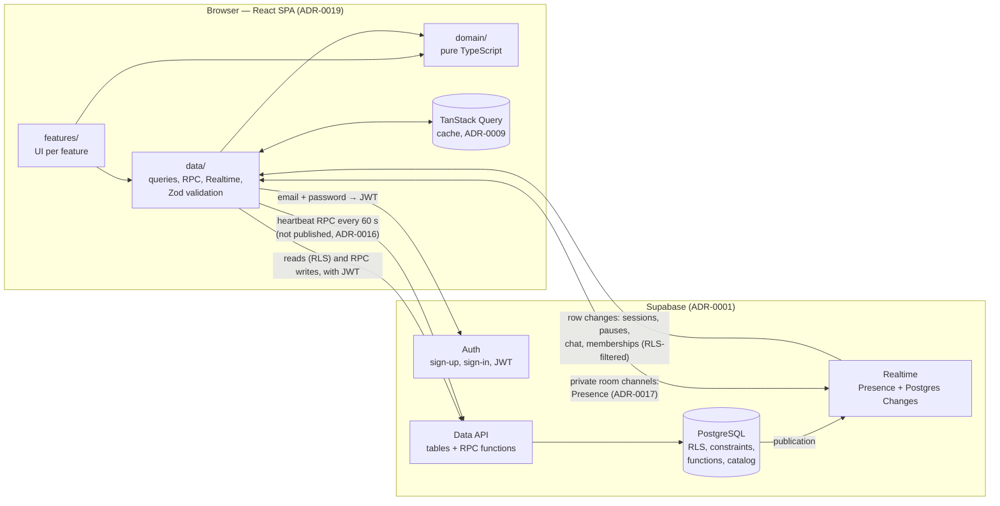
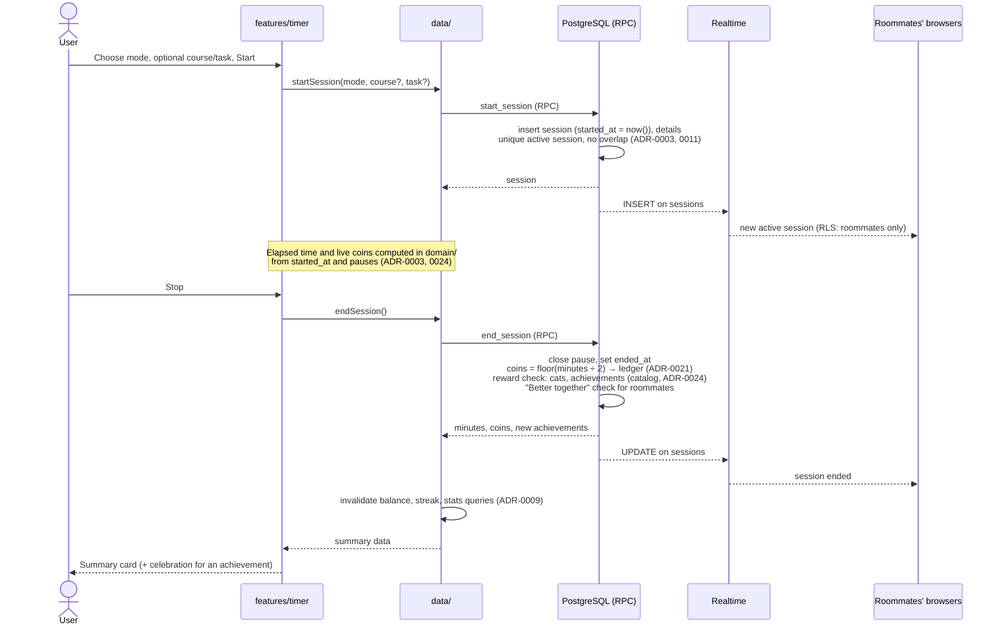
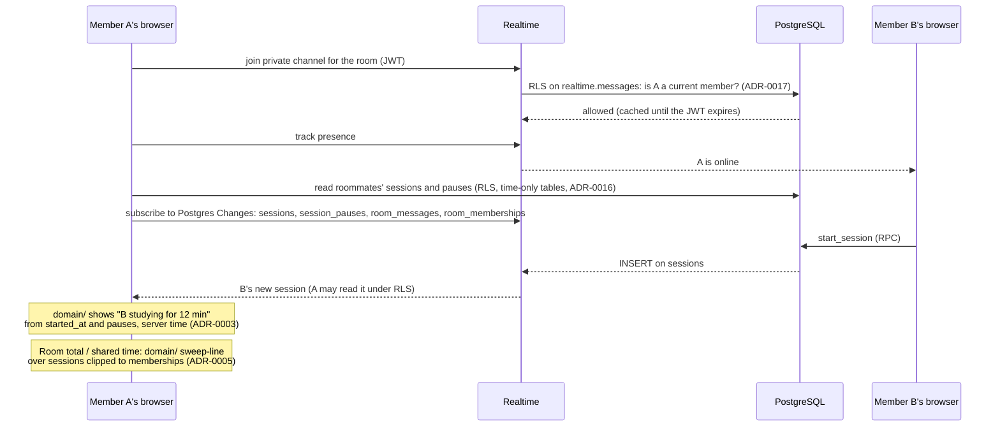
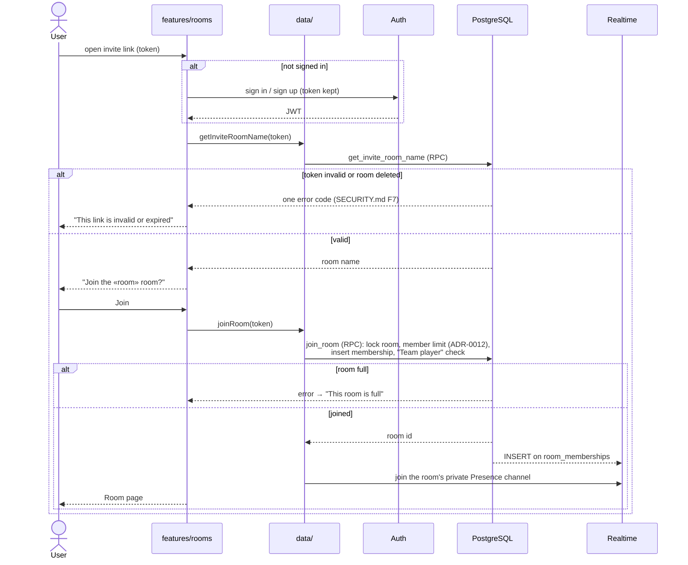

# Architecture overview

Last updated: 2026-11-23 · Phase 0 · **Status: reviewed (task 011-v2)**

A summary of how the parts fit together. It makes **no new decisions**: everything here
comes from Accepted ADRs and the design documents ([DATABASE.md](DATABASE.md),
[SECURITY.md](SECURITY.md), [GAMIFICATION.md](GAMIFICATION.md), [UI_UX.md](UI_UX.md)).
The Phase 1 folder structure and the shared test cases in §5 were proposed here and
accepted as ADR-0029. If this document and an ADR disagree, the
ADR wins.

## Contents

1. [System diagram](#1-system-diagram)
2. [Layers](#2-layers)
3. [Main flows](#3-main-flows)
4. [Where is it calculated](#4-where-is-it-calculated)
5. [Phase 1 folder structure](#5-phase-1-folder-structure)
6. [Decision map](#6-decision-map)

---

## 1. System diagram

A client-rendered single-page app talks **directly** to Supabase; there is no custom API
server (ADR-0001, ADR-0019). All backend rules live in the database: RLS, constraints and
functions.



| Data | Path | Source |
| --- | --- | --- |
| Sign-up, sign-in, access token | Browser → **Auth**; supabase-js refreshes the JWT | ADR-0001, ADR-0027 |
| Reads (sessions, rooms, catalog, stats data) | Browser → **Data API** → PostgreSQL, filtered by RLS | DATABASE.md §4 |
| Writes to timer, rooms, roles, rewards, shop | Browser → **RPC function** (checks `auth.uid()` and rules) → PostgreSQL | DATABASE.md §5, ADR-0027 |
| Direct writes (profile name, settings, courses, tasks, chat, equipment) | Browser → Data API, checked by RLS and constraints | DATABASE.md §4 |
| Online / offline | Browser ↔ **Realtime Presence**, one private channel per room; never stored | ADR-0006, ADR-0017 |
| Studying status, pauses, chat, membership changes | PostgreSQL → **Postgres Changes** → subscribed browsers whose RLS allows the row | ADR-0006, DATABASE.md §6 |
| Heartbeat | Browser → RPC every 60 s → a table outside the Realtime publication | ADR-0016 |
| Catalog (cats, items, achievements, placement values) | Migration → PostgreSQL → read by the browser | ADR-0024, ADR-0028 |
| Art (cat and item images) | Static files served with the app | ADR-0028, §5 |

Only the **publishable key** is in the browser; the secret key is never used by the app
(ADR-0027, SECURITY.md K1).

---

## 2. Layers

From ADR-0002 (partly superseded by ADR-0024 for streak and reward rules), ADR-0009 and
ADR-0015.

| Layer | Responsibility | May import | May **not** import |
| --- | --- | --- | --- |
| `domain/` | Pure TypeScript: timer state (elapsed time from `started_at` and pauses), personal statistics, room statistics and the shared-time sweep-line (ADR-0005), live coin display `minutes ÷ 2` (ADR-0024 exception), item placement math (ADR-0028), types | Nothing outside `domain/` | React, Supabase, `data/`, `features/` |
| `data/` | Supabase queries and RPC calls; Realtime subscriptions that update or invalidate TanStack Query caches (ADR-0009); **Zod validation** of everything that comes from the network and of route params, before it reaches `domain/` (ADR-0002, ADR-0015); mapping database error codes (e.g. `23P01`) to i18n keys | `domain/` (types) | React components, `features/` |
| `features/` | UI per feature (timer, courses, statistics, rooms, chat, Karamel, achievements, settings): screens, components, hooks; all text through i18n keys (ADR-0010) | `domain/`, `data/`, `shared/ui/` | Another feature's internals (ADR-0029) |

What is **not** in `domain/` any more: **streak** and **reward rules** (coin grants, cat
unlocks, achievements). They exist only in SQL; the UI reads their results (ADR-0024).

Rules that cross layers:

- `domain/` is the main target of Vitest unit tests (ADR-0002, ADR-0018).
- Server state lives in TanStack Query; no client-only global state library until needed
  (ADR-0009, OPEN_QUESTIONS #8).
- Routing is React Router in declarative mode; data loading stays in TanStack Query, not in
  router loaders (ADR-0015).

---

## 3. Main flows

### 3.1 Start and end a session → coins and achievements



Pomodoro breaks are pauses written by `pause_session`, at the exact end of the 25-minute
work phase even if the page was closed (UI_UX.md §3.3, DATABASE.md §5.1).

### 3.2 Live status in a room (Presence + active session)



A user joins the channels of **all** their rooms (ADR-0006). A removed member may keep
Presence until their JWT expires (1 hour, ADR-0027; SECURITY.md §2.3).

### 3.3 Buy and equip an item

```mermaid
sequenceDiagram
    actor U as User
    participant F as features/karamel
    participant D as data/
    participant DM as domain/
    participant DB as PostgreSQL

    F->>D: load items, cats (with placement values), owned items, equipment, balance
    D->>DB: reads (catalog readable by signed-in users; own rows only)
    DB-->>D: rows
    D->>DM: validated data (Zod)
    DM-->>F: item positions on Karamel (placement rules, ADR-0028)
    U->>F: click an item not owned → preview (not saved)
    alt balance ≥ price and not negative
        U->>F: Buy (price)
        F->>D: buyItem(key)
        D->>DB: buy_item (RPC): per-user lock, balance check,<br/>user_items + ledger entry −price (ADR-0021)
        DB-->>D: ok
        D->>D: invalidate balance, owned items
    else not enough coins
        F-->>U: disabled button: "study X more minutes", X = 2 × (price − balance)
    end
    U->>F: click an owned item
    F->>D: equip(cat, slot, item) / unequip
    D->>DB: write cat_equipment (RLS: own rows; FKs: owned cat and item, matching slot)
    DB-->>D: ok
```

### 3.4 Join a room by link



---

## 4. Where is it calculated

Rule (ADR-0024): calculations that **affect rewards** run **only in SQL**; **display-only**
calculations run in **TypeScript** (`domain/`). Two exceptions exist in both, with the same
test cases in Vitest and pgTAP.

| Calculation | SQL | TS | Basis |
| --- | --- | --- | --- |
| Elapsed time of the active session (live) | — | ✅ `domain/` | ADR-0003 |
| Study minutes of a session (for coins) | ✅ | ✅ display only | ADR-0003, ADR-0021 |
| Coins of a session `floor(minutes ÷ 2)` | ✅ `end_session`, `edit_session`, `add_manual_session` | — | ADR-0021, ADR-0024 |
| Live coin display of the active session | — | ✅ (exception) | ADR-0024 |
| Correction entries after an edit or delete | ✅ | — | ADR-0021, DATABASE.md #52 |
| Balance (sum of the ledger) | ✅ | — | ADR-0008 |
| Streak (current and longest) | ✅ | — (reads the result) | ADR-0022, ADR-0024 |
| Daily and weekly minutes for rewards (streak, "Star of the week") | ✅ | — | ADR-0022, ADR-0024 |
| Personal statistics, charts, goal met, study calendar | — | ✅ | ADR-0024, ADR-0025, UI_UX.md |
| Member's time in a room, room total time | — | ✅ | ADR-0005 |
| Room shared time | ✅ for "Better together" | ✅ for display (exception) | ADR-0005, ADR-0024 |
| Cat unlocks and achievements | ✅ reward check | — | ADR-0020, ADR-0021, ADR-0024 |
| Shop checks (balance, ownership) | ✅ `buy_item` | — (only the "X more minutes" hint) | ADR-0021 |
| "X more minutes" hint = 2 × (price − balance) | — | ✅ | UI_UX.md §2.7 |
| Item placement on a cat | — (stores the values) | ✅ | ADR-0028 |
| Cat landmarks and hood openings | — | Computed once when art is added, then stored by migration | ADR-0028 |

---

## 5. Phase 1 folder structure

Decided in [ADR-0029](decisions/0029-phase-1-folder-structure.md) (extends ADR-0002).
Nothing is created before Phase 1.

```
karamel-hub/
├── docs/                       # Phase 0 documents (unchanged); docs/assets/README.md stays as the art spec
├── public/
│   └── art/                    # images moved from docs/assets/ (cats/, items/head/, items/neck/)
├── src/
│   ├── app/                    # entry, providers (TanStack Query, i18n), router, layout (menu, timer strip)
│   ├── domain/                 # pure TS (ADR-0002); tests next to files: *.test.ts
│   │   ├── timer/  stats/  rooms/  placement/
│   ├── data/                   # Supabase client, queries, RPC, Realtime, Zod schemas
│   │   ├── supabase.ts  sessions/  rooms/  chat/  gamification/  settings/
│   ├── features/               # one folder per feature
│   │   ├── auth/  home/  timer/  courses/  stats/  rooms/  chat/  karamel/  achievements/  settings/  invite/
│   ├── shared/ui/              # shared presentational components (card, ring, button)
│   └── locales/
│       ├── tr/                 # one JSON file per feature namespace (ADR-0010)
│       └── en/
├── supabase/
│   ├── config.toml
│   ├── migrations/             # schema, RLS, functions, catalog data (ADR-0018, ADR-0024)
│   ├── seed.sql                # local development data only
│   └── tests/                  # pgTAP tests (supabase test db)
├── tests/
│   ├── integration/            # supabase-js RLS tests against the local stack (ADR-0018)
│   └── shared-cases/           # test cases shared by Vitest and pgTAP (#77)
├── e2e/                        # Playwright critical flows
└── tools/                      # scripts: cat landmarks and hood openings from images (ADR-0028)
```

Notes on the proposal:

- **`src/app/` and `src/shared/ui/`** are not named in ADR-0002. `shared/ui/` holds
  presentational components with no data access; it imports nothing from `data/` or
  `features/`. Features do not import each other's internals (ADR-0029).
- **Art** moves to `public/art/` so that file names stay the catalog keys at runtime
  (`public/art/items/head/frog-hood.png`); `docs/assets/README.md` stays in `docs/` as the
  specification (ADR-0029).
- **Shared test cases** (ADR-0024 exceptions: `minutes ÷ 2`, room shared time): one
  data file read by Vitest, and the same cases turned into a pgTAP test by a script in
  `tools/` (ADR-0029).
- Whether `supabase test db` reads pgTAP files from `supabase/tests/` by default is
  **[not verified]**; check when the project is set up.

---

## 6. Decision map

Sections: **§1** system · **§2** layers · **§3** flows · **§4** calculations · **§5**
folders. Other documents are named where an ADR mainly affects them.

| ADR | Status | One line | Affects |
| --- | --- | --- | --- |
| [0001](decisions/0001-backend-supabase.md) | Accepted | Supabase (Auth, PostgreSQL, Realtime); backend logic in the database | §1, §3 |
| [0002](decisions/0002-frontend-layering.md) | Partially superseded by 0024; extended by 0029 | `domain/` · `data/` · `features/` layering | §2, §5 |
| [0003](decisions/0003-timer-and-session-model.md) | Accepted | One active personal session, no `room_id`, `started_at` + pauses, server time | §3.1, §3.2, §4 |
| [0004](decisions/0004-room-model.md) | Superseded by 0013 | Single-owner rooms | — |
| [0005](decisions/0005-room-statistics.md) | Accepted | Room stats derived; total vs shared time (sweep-line); never summed across rooms | §3.2, §4 |
| [0006](decisions/0006-realtime-and-privacy.md) | Accepted | Presence per room; status from the active session; time-only visibility | §1, §3.2 |
| [0007](decisions/0007-forgotten-timer-and-session-editing.md) | Accepted | No auto-stop; heartbeat suggestion; free editing and manual sessions | §1, §4 |
| [0008](decisions/0008-coin-ledger.md) | Accepted | Coin ledger; rewards granted by database functions | §3.1, §3.3, §4 |
| [0009](decisions/0009-server-state-tanstack-query.md) | Accepted | TanStack Query for server state; Realtime updates the cache | §1, §2, §3 |
| [0010](decisions/0010-i18n-principle.md) | Accepted | Key-based i18n, feature namespaces, TR + EN, user's timezone for "day" | §2, §5 |
| [0011](decisions/0011-sessions-never-overlap.md) | Accepted | Sessions never overlap; exclusion constraint | §3.1 |
| [0012](decisions/0012-room-member-limit.md) | Accepted | Per-room member limit, checked in the database | §3.4 |
| [0013](decisions/0013-room-model-multiple-owners.md) | Superseded by 0014 | Multiple owners | — |
| [0014](decisions/0014-room-model-creator-role.md) | Accepted | Multiple owners, one transferable creator role; empty rooms deleted | §3.4; DATABASE.md §5.5 |
| [0015](decisions/0015-frontend-libraries.md) | Accepted | i18next, React Router (declarative), Recharts, Zod | §2, §5 |
| [0016](decisions/0016-database-implementation-rules.md) | Accepted | Overlap via GiST; time-only room-readable tables; heartbeat table outside Realtime | §1, §3.2 |
| [0017](decisions/0017-realtime-private-channels.md) | Accepted | Private Realtime channels with RLS on `realtime.messages` | §1, §3.2, §3.4 |
| [0018](decisions/0018-local-development-and-testing.md) | Accepted | Supabase CLI + Docker; migrations in git; Vitest, Playwright, pgTAP, supabase-js tests | §5 |
| [0019](decisions/0019-react-typescript-vite.md) | Accepted | React + TypeScript + Vite; client-rendered SPA | §1, §5 |
| [0020](decisions/0020-cat-unlocks.md) | Partially superseded by 0028 | Cats unlocked by study time and longest streak; permanent | §4; GAMIFICATION.md |
| [0021](decisions/0021-coin-economy-and-shop.md) | Partially superseded by 0028 | 30 coins/hour, corrections on edits, negative balance blocks buying; achievements | §3.1, §3.3, §4 |
| [0022](decisions/0022-streak-definition.md) | Accepted | ≥ 25 min/day, user's midnight, 1 forgiven day per calendar week | §4 |
| [0023](decisions/0023-invite-link-visible-to-members.md) | Accepted | All members see and share the invite link | §3.4 |
| [0024](decisions/0024-gamification-catalog-in-database.md) | Accepted | Catalog in the database; reward calculations only in SQL (two shared exceptions) | §2, §4, §5 |
| [0025](decisions/0025-study-goals.md) | Accepted | `profiles` = display name; private `user_settings`; optional goals | §1, §4 |
| [0026](decisions/0026-account-deletion.md) | Accepted | Account deletion removes the user's data; creator role handed over (later phase) | DATABASE.md §5.5 |
| [0027](decisions/0027-security-baseline.md) | Accepted | Security baseline for the friend-group stage (functions, tokens, keys, JWT) | §1, §3; SECURITY.md |
| [0028](decisions/0028-first-version-catalog.md) | Accepted | One cat (Karamel), 13 items; placement data in the catalog | §2, §3.3, §4, §5 |
| [0029](decisions/0029-phase-1-folder-structure.md) | Accepted | Phase 1 folder structure; shared Vitest/pgTAP test cases | §2, §5 |
