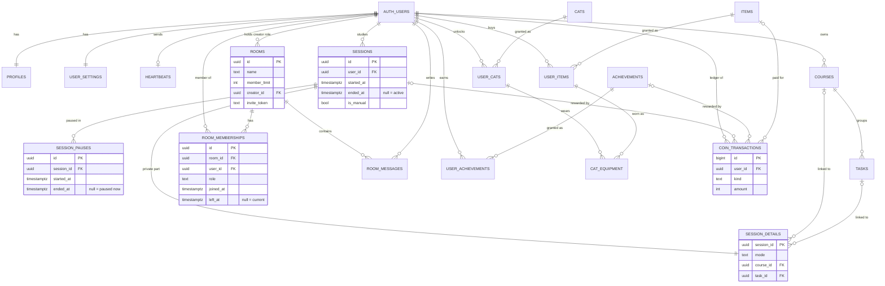

# Database design

Last updated: 2026-11-22 · Phase 0 · **Status: draft for review (task 007)**

This is a design document. It contains no SQL and no migrations; those are written in
Phase 1 (ADR-0018). It is based only on Accepted ADRs and [CURRENT_STATE.md](CURRENT_STATE.md).
Design decisions that no ADR made were proposed in task 007 and accepted by the user in
task 007-v2 (former OPEN_QUESTIONS #49–#58); they carry their number, e.g. (#53). Security analysis (threats, attack
scenarios) belongs in `SECURITY.md`; this document only has the access table (§4).

Labels: **[not verified]** = a technical assumption to check in Phase 1.

## Contents

1. [Tables](#1-tables)
2. [Relationship diagram](#2-relationship-diagram)
3. [Constraints](#3-constraints)
4. [Access table (RLS)](#4-access-table-rls)
5. [Database functions](#5-database-functions)
6. [Realtime](#6-realtime)
7. [Computed values](#7-computed-values)
8. [Design notes and assumptions](#8-design-notes-and-assumptions)

## Conventions

- **Platform:** Supabase PostgreSQL (ADR-0001). Users come from Supabase Auth
  (`auth.users`); every user-owned table references `auth.users(id)` with
  **on delete cascade**, so deleting the account removes the user's rows (ADR-0026) once
  the account-deletion function has handed over roles (§5.5).
- **Types:** `uuid` ids (`gen_random_uuid()`), `timestamptz` for every point in time,
  `int` for minutes and coins, `text` with `CHECK` constraints instead of enum types (so
  values can be added in a migration without `ALTER TYPE`).
- **Server time:** every timestamp that the timer depends on is set by the database with
  `now()`, never sent by the client (ADR-0003). Edited and manual sessions are the
  exception: the user chooses those times (ADR-0007).
- **Writes go through functions.** Tables that hold timer, room, role or reward data are
  read directly but written only by database functions (§5), so every rule is checked in
  one place (ADR-0001, ADR-0008, ADR-0014). Direct writes are allowed only where no rule
  depends on them (marked in §4).
- **Names of catalog entries** are i18n keys, not stored text (ADR-0010).

---

## 1. Tables

Nullable: **no** = `NOT NULL`, **yes** = may be `NULL`.

### 1.1 Users

#### `profiles` — public part of a user (ADR-0025, ADR-0014)

Holds **only the display name**. Room members can read it; former members and strangers
cannot (ADR-0014: you see another user only if you share a room).

| Column | Type | Nullable | Notes |
| --- | --- | --- | --- |
| `user_id` | `uuid` | no | PK; FK → `auth.users.id`, on delete cascade |
| `display_name` | `text` | no | 1–30 characters (#53) |
| `created_at` | `timestamptz` | no | default `now()` |

Created together with `user_settings` when the user signs up (by a trigger on
`auth.users` or by the first sign-in; mechanism chosen in Phase 1).

#### `user_settings` — private settings (ADR-0025)

Only the owner reads it.

| Column | Type | Nullable | Notes |
| --- | --- | --- | --- |
| `user_id` | `uuid` | no | PK; FK → `auth.users.id`, on delete cascade |
| `daily_goal_minutes` | `int` | yes | Optional, no default (ADR-0025); `> 0` when set |
| `weekly_goal_minutes` | `int` | yes | Optional, no default; `> 0` when set; week = ADR-0022 calendar week |
| `timezone` | `text` | no | IANA name, e.g. `Europe/Istanbul`. Initial value from the browser at sign-up (#56) |
| `language` | `text` | no | `tr` or `en` (ADR-0010). Initial value from the browser at sign-up (#56) |
| `updated_at` | `timestamptz` | no | |

### 1.2 Timer and sessions

The split follows ADR-0016: `sessions` and `session_pauses` hold **only user and time
data** and are readable by roommates; everything private about a session is in
`session_details`, readable only by the owner.

#### `sessions` — one study session (ADR-0003, ADR-0007, ADR-0011, ADR-0016)

| Column | Type | Nullable | Notes |
| --- | --- | --- | --- |
| `id` | `uuid` | no | PK |
| `user_id` | `uuid` | no | FK → `auth.users.id`, on delete cascade |
| `started_at` | `timestamptz` | no | Server time when started; user-chosen when edited or added manually |
| `ended_at` | `timestamptz` | yes | `NULL` = active session |
| `is_manual` | `bool` | no | `true` for sessions added by hand (ADR-0007); default `false` |
| `created_at` | `timestamptz` | no | default `now()` |
| `updated_at` | `timestamptz` | no | Changes on edit |

No `room_id` (ADR-0003). No mode, course or task (ADR-0016; they are in
`session_details`).

#### `session_pauses` — pause segments (ADR-0003, ADR-0016)

| Column | Type | Nullable | Notes |
| --- | --- | --- | --- |
| `id` | `uuid` | no | PK |
| `session_id` | `uuid` | no | FK → `sessions.id`, on delete cascade |
| `user_id` | `uuid` | no | Copy of the session's user, for access checks and constraints |
| `started_at` | `timestamptz` | no | |
| `ended_at` | `timestamptz` | yes | `NULL` = the session is paused now |

Pomodoro breaks are stored as pause segments, so break time is not study time and earns
no coins (#50).

#### `session_details` — private part of a session (ADR-0016)

| Column | Type | Nullable | Notes |
| --- | --- | --- | --- |
| `session_id` | `uuid` | no | PK; FK → `sessions.id`, on delete cascade |
| `user_id` | `uuid` | no | Owner, for access checks |
| `mode` | `text` | no | `pomodoro` or `free` (ADR-0003) |
| `course_id` | `uuid` | yes | FK → `courses.id`, on delete set null (#49) |
| `task_id` | `uuid` | yes | FK → `tasks.id`, on delete set null (#49) |

`mode` is kept here, not in `sessions`, because ADR-0016 allows only user and time data in
the room-readable table (accepted in task 007-v2).

#### `heartbeats` — "I am here" signal (ADR-0007, ADR-0016)

One row per user. **Not in the Realtime publication** (ADR-0016). No index on
`last_seen_at`, so updates can be HOT updates (ADR-0016).

| Column | Type | Nullable | Notes |
| --- | --- | --- | --- |
| `user_id` | `uuid` | no | PK; FK → `auth.users.id`, on delete cascade |
| `last_seen_at` | `timestamptz` | no | Server time of the last heartbeat (interval 60 s, ADR-0016) |

### 1.3 Courses and tasks (#49)

The brief lists course and task management, and ADR-0016 says course and task links are
private. Both are owner-only; a session's private details hold an optional course and task.

#### `courses`

| Column | Type | Nullable | Notes |
| --- | --- | --- | --- |
| `id` | `uuid` | no | PK |
| `user_id` | `uuid` | no | FK → `auth.users.id`, on delete cascade |
| `name` | `text` | no | User content, not translated (ADR-0010) |
| `archived_at` | `timestamptz` | yes | Hidden from pickers when set |
| `created_at` | `timestamptz` | no | |

#### `tasks`

| Column | Type | Nullable | Notes |
| --- | --- | --- | --- |
| `id` | `uuid` | no | PK |
| `user_id` | `uuid` | no | FK → `auth.users.id`, on delete cascade |
| `course_id` | `uuid` | yes | FK → `courses.id`, on delete set null |
| `title` | `text` | no | |
| `done_at` | `timestamptz` | yes | Set when completed |
| `created_at` | `timestamptz` | no | |

### 1.4 Rooms

#### `rooms` (ADR-0012, ADR-0014, ADR-0023)

| Column | Type | Nullable | Notes |
| --- | --- | --- | --- |
| `id` | `uuid` | no | PK. Never used in invite links (ADR-0014) |
| `name` | `text` | no | Required, 1–50 characters (#53) |
| `member_limit` | `int` | no | Chosen by the creator, changed by owners (ADR-0012); `> 0`. Upper bound open (#13) |
| `creator_id` | `uuid` | no | The creator-role holder (ADR-0014). FK → `auth.users.id` |
| `invite_token` | `text` | no | Secret, unguessable; unique. Replaced on regeneration (ADR-0014) |
| `created_at` | `timestamptz` | no | |

`creator_id` has no `on delete cascade`: account deletion hands the role over first
(ADR-0026, §5.5). An empty room is deleted (ADR-0014).

#### `room_memberships` — membership history (ADR-0005, ADR-0014)

Each row is one membership interval. A user who leaves and rejoins has several rows.

| Column | Type | Nullable | Notes |
| --- | --- | --- | --- |
| `id` | `uuid` | no | PK |
| `room_id` | `uuid` | no | FK → `rooms.id`, on delete cascade (ADR-0014: deleting a room removes its history) |
| `user_id` | `uuid` | no | FK → `auth.users.id`, on delete cascade (ADR-0026) |
| `role` | `text` | no | `owner` or `member` (ADR-0014). Meaningful only while the row is open |
| `joined_at` | `timestamptz` | no | Server time |
| `left_at` | `timestamptz` | yes | `NULL` = current member |

How a removed member is kept from rejoining is **deferred** (#48); no table is designed
for it.

#### `room_messages` — room chat (ADR-0006)

| Column | Type | Nullable | Notes |
| --- | --- | --- | --- |
| `id` | `uuid` | no | PK |
| `room_id` | `uuid` | no | FK → `rooms.id`, on delete cascade (ADR-0014) |
| `user_id` | `uuid` | no | Author; FK → `auth.users.id`, on delete cascade (ADR-0026) |
| `body` | `text` | no | User content, not translated. 1–1,000 characters (#53) |
| `created_at` | `timestamptz` | no | default `now()` |

Current members see the room's whole history, including messages from before they joined.
Messages cannot be edited or deleted in the first version (#54).

### 1.5 Gamification catalog (ADR-0020, ADR-0021, ADR-0024)

Read-only for users, readable by every signed-in user (ADR-0024). The primary key is the
i18n key suffix (e.g. `frog-hood` → `cats:items.frog-hood.name`, exact key format decided with
the i18n files).

#### `cats`

| Column | Type | Nullable | Notes |
| --- | --- | --- | --- |
| `key` | `text` | no | PK |
| `unlock_type` | `text` | no | `signup`, `total_minutes` or `longest_streak_days` |
| `threshold` | `int` | yes | `NULL` for `signup`; otherwise `> 0` |
| `sort_order` | `int` | no | Display order |
| `eye_x` | `real` | no | Eye centre `ex`, in pixels of the 512×512 cat image |
| `eye_y` | `real` | no | Eye centre `ey` |
| `eye_distance` | `real` | no | `d`, distance between the eye centres; `> 0` |
| `skull_top_y` | `real` | no | Topmost cat pixel in the column `x = ex` |

The four landmark columns (ADR-0028) hold the cat landmarks of the automatic placement method
([assets README](assets/README.md#automatic-placement)). They are computed once per cat
when its art is added and inserted by the catalog migration. The chin is not stored: it is
`eye_y + 0.70 × eye_distance` (assets README).

#### `items`

| Column | Type | Nullable | Notes |
| --- | --- | --- | --- |
| `key` | `text` | no | PK |
| `slot` | `text` | no | `head`, `eyes` or `neck` (ADR-0021) |
| `tier` | `text` | no | `easy`, `medium` or `hard` |
| `price` | `int` | no | `> 0` |
| `sort_order` | `int` | no | |
| `placement_type` | `text` | no | `hood`, `hat`, `bow` or `neck` |
| `width_factor` | `real` | no | Item width (for `hood`: face-opening width) in units of `d`; `> 0` |
| `vertical_offset` | `real` | no | Vertical offset in units of `d`; may be negative |
| `opening_center_x` | `real` | yes | Centre of a hood's face opening, in pixels of the item image. Set only for `hood` |
| `opening_center_y` | `real` | yes | Same, vertical. Set only for `hood` |
| `opening_width` | `real` | yes | Width of a hood's face opening, in pixels of the item image; `> 0`. Set only for `hood` |

Also unique on `(key, slot)`, so `cat_equipment` can check that an item is worn in its own
slot (§3).

The placement columns (ADR-0028) hold the item rules of the automatic placement method
([assets README](assets/README.md#automatic-placement)); the first-version values are in
that README. For `hood` items, the face opening ("the largest fully enclosed transparent
area", assets README) is measured once when the item's art is added and stored in the three
`opening_*` columns; like the cat landmarks, the values are inserted by the catalog
migration (ADR-0028).

#### `achievements`

| Column | Type | Nullable | Notes |
| --- | --- | --- | --- |
| `key` | `text` | no | PK |
| `condition_type` | `text` | no | See below |
| `threshold` | `int` | no | `> 0`; minutes or count |
| `coins` | `int` | no | `BETWEEN 20 AND 75` (ADR-0021) |
| `sort_order` | `int` | no | |

Condition types needed for the five achievements:

| `condition_type` | Meaning | Used by |
| --- | --- | --- |
| `session_minutes` | One session with at least `threshold` minutes of study time | First step (25), Marathon (180) |
| `rooms_joined` | Joined or created at least `threshold` rooms | Team player (1) |
| `room_shared_minutes` | At least `threshold` minutes of shared time with others in one room | Better together (60) |
| `week_minutes` | At least `threshold` minutes in one calendar week (ADR-0022) | Star of the week (600) |

#### Catalog content (first version)

Loaded by a migration (values from ADR-0020 and ADR-0021):

| Table | Rows |
| --- | --- |
| `cats` | `karamel` (signup) — the only first-version cat (ADR-0028) |
| `items` | head: `red-gingham-bow` easy 50 · `pink-visor` easy 50 · `yellow-bucket-hat` easy 50 · `denim-cap` medium 150 · `plaid-beret` medium 150 · `plaid-bucket-hat` medium 200 · `frog-hood` hard 300 · `bunny-hood` hard 300 · `strawberry-bonnet` hard 350 · `sunflower-bonnet` hard 400; neck: `red-gingham-bandana` easy 50 · `bear-plaid-bandana` easy 50 · `lace-collar` medium 250 (ADR-0028) |
| `achievements` | `first_step` session_minutes 25, 20 coins · `team_player` rooms_joined 1, 30 · `better_together` room_shared_minutes 60, 50 · `marathon` session_minutes 180, 50 · `star_of_the_week` week_minutes 600, 75 |

Cat and item keys are the asset file names (`public/art/`, formerly `docs/assets/`; ADR-0028, ADR-0029). Achievement keys
are a naming suggestion only. The `total_minutes` and `longest_streak_days` unlock types
stay in the schema for later cats; no first-version cat uses them (ADR-0028).

#### How the catalog is loaded

- The rows are inserted by a **migration** in `supabase/migrations/` (ADR-0018, ADR-0024),
  not by `supabase/seed.sql`: seed data is for local development, while the catalog must
  exist on the hosted database too.
- A later change (new item, new price) is a **new migration** that inserts or updates rows.
  Rows that users already hold (`user_cats`, `user_items`, `user_achievements`) are never
  deleted; the foreign keys use `on delete restrict`.
- A price change does not change history: the ledger stores each entry's amount (ADR-0024).

### 1.6 Gamification grants and ledger (ADR-0008, ADR-0020, ADR-0021)

All rows here are written only by database functions (ADR-0008). Grants are permanent.

#### `user_cats`

| Column | Type | Nullable | Notes |
| --- | --- | --- | --- |
| `user_id` | `uuid` | no | FK → `auth.users.id`, on delete cascade |
| `cat_key` | `text` | no | FK → `cats.key`, on delete restrict |
| `unlocked_at` | `timestamptz` | no | |

PK `(user_id, cat_key)`.

#### `user_items`

| Column | Type | Nullable | Notes |
| --- | --- | --- | --- |
| `user_id` | `uuid` | no | FK → `auth.users.id`, on delete cascade |
| `item_key` | `text` | no | FK → `items.key`, on delete restrict |
| `purchased_at` | `timestamptz` | no | |

PK `(user_id, item_key)`.

#### `user_achievements`

| Column | Type | Nullable | Notes |
| --- | --- | --- | --- |
| `user_id` | `uuid` | no | FK → `auth.users.id`, on delete cascade |
| `achievement_key` | `text` | no | FK → `achievements.key`, on delete restrict |
| `earned_at` | `timestamptz` | no | |

PK `(user_id, achievement_key)` — the unique constraint of ADR-0008.

#### `cat_equipment` — what each cat wears (ADR-0021)

| Column | Type | Nullable | Notes |
| --- | --- | --- | --- |
| `user_id` | `uuid` | no | FK → `auth.users.id`, on delete cascade |
| `cat_key` | `text` | no | |
| `slot` | `text` | no | `head`, `eyes` or `neck` |
| `item_key` | `text` | no | |

PK `(user_id, cat_key, slot)`. Foreign keys: `(user_id, cat_key)` → `user_cats`,
`(user_id, item_key)` → `user_items`, `(item_key, slot)` → `items(key, slot)`.

#### `coin_transactions` — the ledger (ADR-0008, ADR-0021)

| Column | Type | Nullable | Notes |
| --- | --- | --- | --- |
| `id` | `bigint` | no | PK, identity |
| `user_id` | `uuid` | no | FK → `auth.users.id`, on delete cascade |
| `kind` | `text` | no | `session_reward`, `session_correction`, `achievement`, `purchase` |
| `amount` | `int` | no | Positive or negative; never `0` |
| `session_id` | `uuid` | yes | Set for `session_reward` and `session_correction` |
| `achievement_key` | `text` | yes | Set for `achievement`; FK → `achievements.key` |
| `item_key` | `text` | yes | Set for `purchase`; FK → `items.key` |
| `created_at` | `timestamptz` | no | default `now()` |

`session_id` has **no foreign key**: a user can delete a session (#52), and its ledger rows
stay, with a correction that brings the session's coins to 0 (§5.2).

No balance column (ADR-0008); the balance is computed (§7).

---

## 2. Relationship diagram

`auth.users` is Supabase's table. Catalog tables are on the right.

Only the main columns are shown in the diagram; §1 has the full lists.

---

## 3. Constraints

"Function" means the rule is checked inside a database function (§5) because a plain
constraint cannot express it.

### Sessions and timer

| Rule | How | Protects |
| --- | --- | --- |
| One active session per user | Partial unique index on `sessions(user_id)` where `ended_at IS NULL` | ADR-0003 |
| A user's sessions never overlap | Exclusion constraint `USING gist`: `user_id` with `=`, range `tstzrange(started_at, ended_at)` with `&&` (needs `btree_gist`) | ADR-0011, ADR-0016 |
| Active session counts as open-ended | A `NULL` upper bound makes the range unbounded (PostgreSQL range types; TECH_RESEARCH §5) | ADR-0011 |
| Touching sessions are allowed | The two-argument range constructor is half-open `[)`, so `end = next start` does not overlap | ADR-0011 |
| A session ends after it starts | `CHECK (ended_at IS NULL OR ended_at > started_at)` | data integrity |
| One open pause per session | Partial unique index on `session_pauses(session_id)` where `ended_at IS NULL` | ADR-0003 |
| Pauses of a session never overlap | Exclusion constraint: `session_id` with `=`, pause range with `&&` | elapsed time is correct (ADR-0003) |
| A pause ends after it starts | `CHECK (ended_at IS NULL OR ended_at > started_at)` | data integrity |
| Pauses lie inside their session | Function (start/pause/edit functions) | elapsed time is correct |
| Only finished sessions can be edited | Function `edit_session` | ADR-0007 |
| Edited or manual times are not in the future | Function: `ended_at` ≤ `now()` (#57) | data integrity |

An overlapping insert or edit fails with SQLSTATE `23P01`; the UI maps it to a translated
message (ADR-0011, ADR-0016).

### Rooms

| Rule | How | Protects |
| --- | --- | --- |
| Invite token is unique | Unique constraint on `rooms.invite_token` | ADR-0014 |
| Member limit is positive | `CHECK (member_limit > 0)` | ADR-0012 |
| A user has at most one open membership per room | Partial unique index on `room_memberships(room_id, user_id)` where `left_at IS NULL` | ADR-0014 |
| A user's membership intervals in one room never overlap | Exclusion constraint: `room_id` and `user_id` with `=`, `tstzrange(joined_at, left_at)` with `&&` | ADR-0005 (clipping never double counts) |
| `role` is `owner` or `member` | `CHECK` | ADR-0014 |
| Room never exceeds its limit | Function `join_room`, with the room row locked (`FOR UPDATE`) so two joins at once cannot both pass | ADR-0012 |
| Exactly one creator-role holder, always a current owner | `rooms.creator_id NOT NULL`; that the holder is a current owner is checked by every role function | ADR-0014 |
| The creator-role holder cannot be removed or demoted | Functions `remove_member`, `set_owner_role` | ADR-0014 |
| A room with no members does not exist | Function `leave_room` / `delete_account` deletes the room when the last member leaves | ADR-0014 |

### Rewards and shop

| Rule | How | Protects |
| --- | --- | --- |
| A cat is granted at most once | PK `user_cats(user_id, cat_key)` | ADR-0020 |
| An item is bought at most once | PK `user_items(user_id, item_key)`, and a partial unique index on `coin_transactions(user_id, item_key)` where `kind = 'purchase'` | ADR-0021 |
| An achievement is granted at most once | PK `user_achievements(user_id, achievement_key)`, and a partial unique index on `coin_transactions(user_id, achievement_key)` where `kind = 'achievement'` | ADR-0008, ADR-0021 |
| A session is rewarded at most once | Partial unique index on `coin_transactions(session_id)` where `kind = 'session_reward'` | ADR-0008 (two tabs ending the same session) |
| Each ledger kind has its matching reference | `CHECK` per `kind` (e.g. `purchase` ⇒ `item_key IS NOT NULL` and `amount < 0`) | ADR-0008 |
| No zero entries | `CHECK (amount <> 0)` | ledger stays readable |
| A session's ledger entries sum to `floor(minutes ÷ 2)` | Functions `end_session`, `edit_session`, `add_manual_session`; tested in pgTAP | ADR-0021 |
| No purchase while the balance is negative or below the price | Function `buy_item`, with a per-user lock so two purchases cannot both pass | ADR-0021 |
| One item per slot per cat | PK `cat_equipment(user_id, cat_key, slot)` | ADR-0021 |
| A worn item is owned, and worn in its own slot | FK `(user_id, item_key)` → `user_items`; FK `(item_key, slot)` → `items(key, slot)` | ADR-0021 |
| A cat wearing items is unlocked | FK `(user_id, cat_key)` → `user_cats` | ADR-0020 |
| Achievement coins are between 20 and 75 | `CHECK (coins BETWEEN 20 AND 75)` on `achievements` | ADR-0021 |
| Item slot and tier values | `CHECK` on `items.slot`, `items.tier` | ADR-0021 |
| Placement type matches the slot | `CHECK`: `neck` type ⇔ `neck` slot; `hood`, `hat`, `bow` ⇒ `head` slot | ADR-0028 |
| Hood opening only for hoods | `CHECK`: `placement_type = 'hood'` ⇒ `opening_center_x`, `opening_center_y`, `opening_width` all `NOT NULL`; otherwise all three `NULL` | ADR-0028 |
| Placement values are positive | `CHECK`: `eye_distance > 0`, `width_factor > 0`, `opening_width > 0` when set | ADR-0028 |

### Settings

| Rule | How | Protects |
| --- | --- | --- |
| Goals are positive when set | `CHECK (daily_goal_minutes IS NULL OR daily_goal_minutes > 0)`, same for weekly | ADR-0025 |
| Language is supported | `CHECK (language IN ('tr', 'en'))` | ADR-0010 |
| Text lengths | `CHECK` on character length: display name 1–30, room name 1–50, chat message 1–1,000 | #53 |
| Timezone is a valid IANA name | Function or trigger (a `CHECK` cannot look up time zones) | ADR-0010, ADR-0022 |

---

## 4. Access table (RLS)

Who can do what with **direct table access** through the Supabase API. Everything that is
"nobody" here may still be changed by a database function (§5), which checks its own rules.

- **self** — the user the row belongs to.
- **roommate** — a user who is **currently** a member of a room together with the row's
  user (ADR-0014 visibility rule).
- **room member** — a current member of the row's room.
- **owner** — a current owner of the row's room.
- **signed-in** — any authenticated user.
- **nobody** — no direct access; only through the function named.

| Table | Read | Insert | Update | Delete |
| --- | --- | --- | --- | --- |
| `profiles` | self, roommate | nobody (created at sign-up) | self (`display_name`) | nobody (`delete_account`) |
| `user_settings` | self | nobody (created at sign-up) | self | nobody (`delete_account`) |
| `sessions` | self; roommate ¹ | nobody (`start_session`, `add_manual_session`) | nobody (`end_session`, `edit_session`) | nobody (`delete_session`) |
| `session_pauses` | self; roommate ¹ | nobody (`pause_session`) | nobody (`resume_session`, `edit_session`) | nobody (`edit_session`, `delete_session`) |
| `session_details` | self | nobody (`start_session`, `add_manual_session`) | self (`course_id`, `task_id`) ² | nobody |
| `heartbeats` | self | nobody (`heartbeat`) | nobody (`heartbeat`) | nobody |
| `courses` ² | self | self | self | self |
| `tasks` ² | self | self | self | self |
| `rooms` | room member | nobody (`create_room`) | nobody (`set_member_limit`, `regenerate_invite_link`, `transfer_creator_role`) | nobody (`delete_room`) |
| `room_memberships` | room member ³ | nobody (`create_room`, `join_room`) | nobody (role and leave functions) | nobody |
| `room_messages` | room member, whole history (#54) | room member, as self | nobody (#54) | nobody (#54) |
| `cats`, `items`, `achievements` | signed-in | nobody (migrations) | nobody (migrations) | nobody (migrations) |
| `user_cats` | self | nobody (reward functions) | nobody | nobody |
| `user_items` | self | nobody (`buy_item`) | nobody | nobody |
| `user_achievements` | self | nobody (reward functions) | nobody | nobody |
| `cat_equipment` | self | self | self | self |
| `coin_transactions` | self | nobody (reward and shop functions) | nobody | nobody |
| `realtime.messages` (Presence) | room member, for the room's private channel (ADR-0017) | room member (track own presence) | — | — |

1. A roommate can read a session (and its pauses) whose user has a membership interval in
   a room where the reader is currently a member, **and** the session overlaps that
   interval. So sessions from after someone left, or from before they joined, are not
   visible. Former members' sessions inside their old intervals stay readable, because
   room totals include them (ADR-0005, ADR-0014); their profile is not readable, so they
   appear as "former member". RLS filters whole rows, so a session that only partly
   overlaps an interval is visible in full (§8).
2. Courses and tasks are owner-only (#49).
3. Includes former members' rows, needed to clip time to membership intervals (ADR-0005).

All gamification data (cats, equipped items, coins) is visible **only to its owner** in the
first version (#55).

---

## 5. Database functions

All functions run with the caller's identity (`auth.uid()`) and check it themselves. They
are `security definer` where they must write tables that the caller cannot write directly
(§4), with a fixed `search_path` (details in `SECURITY.md`). Errors are raised with codes
that the UI maps to i18n keys (ADR-0010).

### 5.1 Timer

| Function | Input | What it does | Checks |
| --- | --- | --- | --- |
| `start_session` | `mode`, `course_id?`, `task_id?` | Inserts a session with `started_at = now()` and its `session_details` row | No active session (unique index); no overlap (exclusion constraint); course/task belong to the caller |
| `pause_session` | `at?` (Pomodoro only) | Inserts a pause for the caller's active session, with `started_at = now()`, or, for a Pomodoro break, at the exact end of the 25-minute work phase (UI_UX.md #68) | An active session exists; it is not already paused; `at`, if given, is a work-phase end computed from the session's own data and not later than `now()` |
| `resume_session` | — | Sets `ended_at = now()` on the open pause | An open pause exists |
| `heartbeat` | — | Upserts `heartbeats.last_seen_at = now()` | — |
| `end_session` | `ended_at?` (optional: the "end at last heartbeat" suggestion, ADR-0007) | See below | An active session exists; `ended_at`, if given, lies between `started_at` and `now()` |

**`end_session` steps** (one transaction):

1. Close the open pause, if any, at the end time; set `sessions.ended_at`.
2. Compute the session's study minutes: whole minutes of (`ended_at − started_at −
   pauses`) (ADR-0021).
3. Insert a `session_reward` ledger entry of `floor(minutes ÷ 2)` if it is not zero. The
   unique index on `session_reward` makes a second call (two tabs) a no-op.
4. Run the **reward check** (§5.3) for the caller.
5. Run the "Better together" part of the reward check for every user who is currently a
   roommate of the caller, because their shared time may have grown too.

### 5.2 Session edits and manual sessions (ADR-0007, ADR-0021)

| Function | Input | What it does | Checks |
| --- | --- | --- | --- |
| `edit_session` | `session_id`, `started_at`, `ended_at` | Updates the times; clips pauses to the new range and removes pauses entirely outside it (#51); recomputes coins and writes a `session_correction` for the difference (if not zero); runs the reward check for the caller and the "Better together" check for roommates | The session belongs to the caller and is finished; `started_at < ended_at`; `ended_at` not later than `now()` (#57); no overlap (exclusion constraint) |
| `add_manual_session` | `started_at`, `ended_at`, `mode`, `course_id?`, `task_id?` | Inserts a session with `is_manual = true` and its details; writes a `session_reward` of `floor(minutes ÷ 2)`; runs the reward checks | Same as `edit_session` |
| `delete_session` | `session_id` | Writes a `session_correction` that brings the session's ledger sum to 0 (if not already 0); deletes the session (pauses and details by cascade). Grants already given stay (ADR-0020, ADR-0021) | The session belongs to the caller and is finished (#52) |

Achievement coins are never taken back (ADR-0021); edits only write session corrections.

### 5.3 Reward check (ADR-0020, ADR-0021, ADR-0022, ADR-0024)

An internal function, called by the timer, edit and room functions. It reads the catalog
tables, so no threshold is written in the function itself (ADR-0024). For each catalog
entry the user does not hold yet:

| Grant | Condition (from the catalog) | Grant |
| --- | --- | --- |
| Cat, `total_minutes` | Sum of study minutes of all finished sessions ≥ `threshold` | `user_cats` row |
| Cat, `longest_streak_days` | Longest streak (§7) ≥ `threshold` | `user_cats` row |
| Achievement, `session_minutes` | Any finished session has ≥ `threshold` study minutes | `user_achievements` row + `achievement` ledger entry of `coins` |
| Achievement, `rooms_joined` | Number of rooms ever joined or created ≥ `threshold` | same |
| Achievement, `room_shared_minutes` | In some room, shared time with at least one other member ≥ `threshold` (§7) | same |
| Achievement, `week_minutes` | Some calendar week (ADR-0022) has ≥ `threshold` study minutes | same |

Inserts use "do nothing on conflict", so a repeated check never grants twice. Grants are
never removed (ADR-0020, ADR-0021). The starter cat (`karamel`) is granted at sign-up, together with
`profiles` and `user_settings`.

### 5.4 Shop and cats

| Function | Input | What it does | Checks |
| --- | --- | --- | --- |
| `buy_item` | `item_key` | Inserts `user_items` and a `purchase` ledger entry of `−price` | Takes a per-user lock; balance ≥ 0 and ≥ price (ADR-0021); not already owned (PK) |

Equipping is a direct write to `cat_equipment` (§4); the foreign keys check ownership and
the slot.

### 5.5 Rooms and roles (ADR-0012, ADR-0014, ADR-0023, ADR-0026)

| Function | Input | What it does | Checks |
| --- | --- | --- | --- |
| `create_room` | `name`, `member_limit` | Inserts the room with a new random token, `creator_id = caller`; inserts the caller's membership as `owner`; runs the `rooms_joined` check (creating counts, ADR-0021) | Valid limit (upper bound #13) |
| `get_invite_room_name` | `invite_token` | Returns only the room's name for a valid token, for the invite confirmation screen (UI_UX.md #73) | Caller is signed in; a wrong token and a deleted room give the same error (SECURITY.md F7) |
| `join_room` | `invite_token` | Locks the room; inserts a membership as `member`; runs the `rooms_joined` check | Token matches an existing room; caller is not a current member; open memberships < `member_limit` (ADR-0012). Rejoin after removal: #48 (deferred) |
| `regenerate_invite_link` | `room_id` | Replaces `invite_token` with a new random value; the old link stops working at once | Caller is an owner |
| `set_member_limit` | `room_id`, `member_limit` | Updates the limit | Caller is an owner; value valid (#13); lowering below the member count: #14 |
| `set_owner_role` | `room_id`, `user_id`, `is_owner` | Makes a member an owner, or takes the role away | Caller is an owner; target is a current member; target is not the creator-role holder when demoting |
| `step_down` | `room_id` | Caller's role becomes `member` | Caller is an owner and not the creator-role holder |
| `remove_member` | `room_id`, `user_id` | Sets `left_at = now()` on the target's membership | Caller is an owner; target is not the creator-role holder; target is not the caller |
| `transfer_creator_role` | `room_id`, `user_id` | Sets `creator_id` to the target; the target becomes an owner if needed; the caller stays an owner | Caller is the creator-role holder; target is a current member |
| `leave_room` | `room_id`, `new_creator_id?` | Sets `left_at = now()`. If the caller holds the creator role, first transfers it to `new_creator_id`. If the caller is the last member, deletes the room | Caller is a member; `new_creator_id` required when the caller holds the role and others remain |
| `delete_room` | `room_id` | Deletes the room; memberships and messages are removed by cascade. No confirmation, no notification (ADR-0014) | Caller is the creator-role holder |
| `delete_account` | — | For each room where the caller holds the creator role: transfers it to the oldest owner, else the oldest member (who becomes an owner); "oldest" = earliest `joined_at` of the current membership. Deletes rooms where the caller is the last member. Then deletes the auth user; all user rows go by cascade (ADR-0026) | — |

Sessions are never written by room functions (ADR-0003).

---

## 6. Realtime

Two Realtime features are used (ADR-0006, ADR-0017): **Presence** on private channels and
**Postgres Changes** on a few tables. Postgres Changes delivers a row only to subscribers
whose RLS allows reading it (TECH_RESEARCH §6), and every change counts against the free
plan's 2M messages/month.

| Table or channel | Realtime | Why |
| --- | --- | --- |
| Presence channel per room (private) | **Yes** | Online/offline; not stored (ADR-0006, ADR-0017) |
| `sessions` | **Yes** | "Studying for 1 h 12 min" comes from the active session row (ADR-0006) |
| `session_pauses` | **Yes** | Roommates see a pause start and end (needed for correct elapsed time) |
| `room_messages` | **Yes** | Live room chat (ADR-0006) |
| `room_memberships` | **Yes** (#58) | Member list and roles update without reloading |
| `heartbeats` | **No, deliberately** | A write every 60 s per user would flood Realtime (ADR-0016) |
| `session_details` | **No, deliberately** | Private; only the owner needs it and the owner wrote it |
| `profiles`, `user_settings` | No | Changes are rare; reloaded with the query |
| `rooms` | No | Limit and link changes are rare; reloaded |
| Catalog tables | No | Change only by migration |
| `user_cats`, `user_items`, `user_achievements`, `cat_equipment`, `coin_transactions` | No | Only the user's own actions change them; the function result returns the new state |
| `courses`, `tasks` | No | Private; own actions only |

Broadcast is not used (ADR-0006).

---

## 7. Computed values

Nothing below is stored as a counter (ADR-0003, ADR-0005, ADR-0022). The rule from
ADR-0024: values that **affect rewards are calculated only in SQL**; **display-only**
values are calculated in TypeScript (`domain/`). Exceptions that exist in both, with the
same test cases in Vitest and pgTAP: `minutes ÷ 2` for the live coin display and room
shared time.

| Value | Where | How |
| --- | --- | --- |
| **Elapsed time** of the active session | TS | Server now − `started_at` − pauses (ADR-0003); the client corrects its clock with the server time; never counts ticks |
| **Study minutes** of a session | SQL (rewards); TS (display) | Whole minutes of (`ended_at − started_at − pauses`) |
| **Coins** of a session | SQL | `floor(minutes ÷ 2)` in `end_session`, `edit_session`, `add_manual_session` |
| **Live coins** of the active session | TS | `floor(minutes ÷ 2)` on the running timer (exception, ADR-0024) |
| **Balance** | SQL | Sum of `coin_transactions.amount` for the user (a function or a `security_invoker` view, ADR-0016) |
| **Total study minutes** (hour cats) | SQL | Sum of study minutes of all finished sessions |
| **Daily minutes** per day | SQL (streak, achievements); TS (charts) | Sessions and pauses split at midnight in the user's timezone (ADR-0022, ADR-0010) |
| **Streak** (current and longest) | SQL | From daily minutes: a day counts with ≥ 25 min; 1 missed day per calendar week (Monday–Sunday) is forgiven and does not add; today is not missed until it ends (ADR-0022). The UI reads the result (ADR-0024) |
| **Week minutes** (Star of the week) | SQL | Daily minutes summed over Monday–Sunday in the user's timezone |
| **Item placement** on a cat | TS | Display-only (ADR-0024): position and size from the cat's landmarks and the item's placement columns, by the rules in the [assets README](assets/README.md#automatic-placement) (ADR-0028) |
| **Personal statistics** (day/week/month, charts, per course) | TS | From the user's own sessions; per-course stats join `session_details` (ADR-0016) |
| **Goal met** | TS | Daily or weekly minutes ≥ the current goal; past days use the current goal (ADR-0025); no goal set → nothing to evaluate |
| **Member's time in a room** | TS | Member's sessions clipped to their membership intervals (ADR-0005) |
| **Room total time** | TS | Sum of all members' and former members' clipped time; never summed across rooms (ADR-0005) |
| **Room shared time** (display) | TS | Sweep-line over clipped intervals: time with ≥ 2 members studying (ADR-0005) |
| **Shared time for "Better together"** | SQL | For one user and one room: time when the user and at least one other member were both studying, each clipped to their membership intervals (ADR-0021, ADR-0024) |

Timezone: daily values use the user's **current** timezone from `user_settings`, past days
included; no timezone history is kept, like goals (#56, ADR-0025).

ADR-0005 allows moving room statistics to a SQL function or daily aggregates later, if
history grows.

---

## 8. Design notes and assumptions

- **[not verified]** That `tstzrange(started_at, ended_at)` with a `NULL` end can be used
  directly in an exclusion constraint (the expression must be immutable). PostgreSQL's
  docs say a `NULL` bound means unbounded; immutability of the expression is to be checked
  in Phase 1, together with `btree_gist` availability (ADR-0016).
- **Account deletion is left to a later phase** (to be placed in `ROADMAP.md`); the design
  in §5.5 follows ADR-0026. **[not verified]** Whether the `auth.users` row can be deleted
  from a database function, or Supabase's admin API is required: **verify in Phase 1**.
  The hand-over steps of `delete_account` stay in the database either way.
- `mode` (Pomodoro or free) is not time data, so it is kept in `session_details`, not in
  the room-readable `sessions` table (ADR-0016; accepted in task 007-v2).
- "Better together" uses only finished sessions; checking roommates at every
  `end_session` and `edit_session` means both users get it when the second one ends
  (accepted in task 007-v2).
- **Partial overlap visibility:** RLS shows whole rows, so a roommate can see the full
  times of a session that only partly overlaps a membership interval (for example, a
  session that started an hour before the user joined). Room statistics still clip it.
  To be reviewed in `SECURITY.md`.
- **Helper functions for RLS:** checks like "is the reader currently in a room with this
  user" are needed by several policies; they are written as small `security definer`
  helper functions to avoid recursive RLS on `room_memberships` (details in
  `SECURITY.md`). They live in the non-exposed schema **`private`**, created in P1-03
  (`supabase/migrations/…_database_base.sql`); `authenticated` has `USAGE` on it, and each
  function needs its own `EXECUTE` grant.
- **Performance:** streak and reward checks scan the user's sessions on every end or edit.
  This is fine for the expected scale (ADR-0017); indexes on `sessions(user_id,
  started_at)` and `room_memberships(room_id)` are planned. Revisit if it becomes slow.
