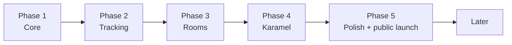

# Roadmap (Phase 1+)

Last updated: 2026-11-24 · **Status: approved by the user (task 012-v2); changed in task 013-v2 (hosted from Phase 1, public launch in Phase 5)**

The **phase order** was decided by the user in task 012 (it resolves OPEN_QUESTIONS #12),
and the roadmap was approved in task 012-v2. The tasks inside each phase are Claude's
breakdown; each task is meant to be **one Claude
Code round** (one prompt, one report). Every task follows [WORKFLOW.md](WORKFLOW.md): the
prompt is saved, a report is written, and the user commits.

The design documents are the source for every task: [DATABASE.md](DATABASE.md),
[SECURITY.md](SECURITY.md), [GAMIFICATION.md](GAMIFICATION.md), [UI_UX.md](UI_UX.md),
[ARCHITECTURE.md](ARCHITECTURE.md) and the ADRs. This roadmap adds no product rules.

## Contents

- [Overview](#overview)
- [Definition of done (every task)](#definition-of-done-every-task)
- [Phase 1 — Core](#phase-1--core)
- [Phase 2 — Tracking](#phase-2--tracking)
- [Phase 3 — Rooms](#phase-3--rooms)
- [Phase 4 — Karamel](#phase-4--karamel)
- [Phase 5 — Polish and public launch](#phase-5--polish-and-public-launch)
- [Later (after Phase 5)](#later-after-phase-5)
- [Phase 0 end check](#phase-0-end-check)

## Overview

| Phase | In one line | Tasks |
| --- | --- | --- |
| 1 Core | Setup and checks, hosted project, auth, layout, courses and tasks, sessions and the timer, deployment for the friend group | 15 |
| 2 Tracking | Daily minutes and streak in SQL, statistics, goals, Home cards, session history and editing | 7 |
| 3 Rooms | Rooms, roles, invite links, Realtime, room statistics, chat, room settings | 9 |
| 4 Karamel | Catalog, ledger and rewards, one-time backfill, shop and dressing, placement, achievements | 9 |
| 5 Polish + public launch | First login, notifications, heartbeat, accessibility; SMTP and email confirmation, 🚀 security items, privacy review, public launch | 10 |

**The user uses the app from Phase 1 on** (task 012-v2). So data from Phase 1 is real:
migrations must keep existing data, and the database holding it is never reset. **A hosted
Supabase project is used from Phase 1 and friends can use the app from Phase 1** (task 013,
ADR-0030), with **new sign-ups closed** once the friends have signed up; the app opens to
the public in Phase 5 with email-confirmed sign-up (ADR-0031). Hosted setup and deployment
are therefore in Phase 1 (P1-03b, P1-14; #79, accepted in task 013-v2). Sessions recorded
before Phase 4 get their coins and achievements from a **one-time backfill** in Phase 4
(P4-06).

## Definition of done (every task)

From [WORKFLOW.md](WORKFLOW.md), applied to every task below:

- Domain logic has unit tests (**Vitest**); critical flows have end-to-end tests
  (**Playwright**).
- Typecheck and tests pass, and the report says how this was checked.
- No hardcoded UI text; **TR and EN keys** exist (ADR-0010).
- **RLS policies exist for every new table**; database rules have **pgTAP** tests
  (ADR-0018, SECURITY.md §3).
- `CURRENT_STATE.md` and related ADRs are updated.
- From P1-03b on: before each `db push` to the hosted project, its data is dumped to a
  git-ignored folder (ADR-0030). Migrations keep data; the hosted database is never reset.
- The user commits; Claude only suggests the message (CLAUDE.md).

---

## Phase 1 — Core

**Goal:** a signed-in user can manage courses and tasks and study with a Pomodoro or free
timer; sessions are stored correctly.

**Scope:** start-of-Phase-1 checks; project scaffold; local Supabase; hosted Supabase
project; profiles and settings; sign-in and sign-up; app layout; courses and tasks;
sessions, pauses and details; timer (Pomodoro 25/5 and free); basic settings (display name,
language, timezone); deployment to Cloudflare for the friend group.

**Out of scope:** statistics, goals, streak (Phase 2); session editing and manual sessions
(Phase 2); rooms and roommate visibility (Phase 3); coins, rewards, Karamel dressing
(Phase 4); browser notifications, heartbeat, first-login flow (Phase 5); public launch,
custom SMTP and email confirmation (Phase 5, ADR-0031).

**Relies on:** ADR-0001, 0002, 0003, 0009, 0010, 0011, 0015, 0016, 0018, 0019, 0025,
0027, 0029, 0030, 0031; UI_UX.md §1, §2.1–§2.3, §2.9, §3.3, §6; DATABASE.md §1.1–§1.3,
§3, §5.1; SECURITY.md §3.4.

**Dependencies:** OPEN_QUESTIONS #41 (Node.js version) and #78 (where the app runs with
real data) were answered in task P1-01 (ADR-0030: Node 26; hosted project from Phase 1).
Also decided in task 013-v2: Nunito as the only font (#80, #81), Cloudflare Workers (#9),
roadmap changes (#79). Creating the hosted project, the Cloudflare account and each
deployment needs the user's explicit permission; the user creates the accounts.

| Task | What | Tests |
| --- | --- | --- |
| **P1-01** Start checks | User decides the Node.js version (#41). Check on the local stack: `btree_gist` and `pgcrypto` available; whether `supabase test db` reads `supabase/tests/`; new key format (`sb_publishable_…`); Fredoka and Nunito cover Turkish characters (ç ğ ı İ ö ş ü) and have tabular digits. Report only; ADRs updated where an assumption changes | — (report with evidence) |
| **P1-02** Scaffold | Vite + React + TypeScript; folders of ADR-0029; import-rule lint; Vitest and Playwright configs; TanStack Query provider; React Router (declarative); i18next with TR/EN namespaces; `.env.example`, `*.local` ignored; Nunito self-hosted (the only font, UI_UX.md §6.3); art moved from `docs/assets/` to `public/art/` | Typecheck, one Vitest and one Playwright smoke test |
| **P1-03** Database base | `supabase init`; first migration: extensions, non-exposed schema for helpers, default `EXECUTE` revoked from `PUBLIC` and `anon` (ADR-0027) | pgTAP: every exposed table has RLS; no function executable by `PUBLIC`/`anon` |
| **P1-03b** Hosted project | The user creates the hosted Supabase project (free plan) following Claude's steps; `supabase link`; P1-03's migration pushed; SECURITY.md §3.4 hosted settings (Realtime public access off, email confirmation off, JWT 1 hour, new keys only); backup with `supabase db dump --data-only` to a git-ignored folder, tested (#79); the "close new sign-ups" step written down and located in the dashboard (the user does it after friends sign up, see P1-14; ADR-0031) | `btree_gist` and `pgcrypto` on the hosted project; §3.4 hosted checks; the dump runs and contains the expected tables |
| **P1-04** Profiles and settings | `profiles`, `user_settings` (goal columns included, unused until Phase 2), creation at sign-up, RLS | pgTAP: self-only settings; profile readable by self |
| **P1-05** Sign-in and sign-up | Auth screens; display name asked at sign-up; route guard; sign-out | Playwright: sign up, sign in, sign out |
| **P1-06** App shell | Left menu (static Karamel image; dressing comes in Phase 4), timer-strip slot, palette and type tokens, shared cards, buttons, rings (UI_UX.md §6) | Vitest for any helper; visual check in the report |
| **P1-07** Courses and tasks: database | `courses`, `tasks`, RLS (#49) | pgTAP: self-only access; foreign keys |
| **P1-08** Courses and tasks: screen | Add, rename, archive courses; add, edit, mark tasks done; Zod validation | Playwright: add a course and a task, mark it done |
| **P1-09** Sessions: database | `sessions`, `session_pauses`, `session_details`; one-active and no-overlap constraints; pause constraints; self-only RLS (roommate policies in Phase 3) | pgTAP: constraints, `23P01`, RLS |
| **P1-10** Timer functions | `start_session`, `pause_session` (with `at` for Pomodoro), `resume_session`, `end_session` (no rewards yet) | pgTAP: `auth.uid()` checks, server time, double end, `at` validation |
| **P1-11** Timer logic | `domain/timer`: elapsed time from `started_at` and pauses; Pomodoro phases 25/5; server-time offset; live coin display deferred to Phase 4 | Vitest: phases, pauses, clock offset |
| **P1-12** Timer UI | Timer card (minimal Home), timer strip on other pages, mode choice, optional course/task, Pomodoro break and "Continue" (#68), in-page phase change only | Playwright: start, pause, resume, stop; Pomodoro phase (with a fake clock) |
| **P1-13** Settings (basic) | Display name, language, timezone (UI_UX.md §2.9) | Playwright: change language; Vitest/Zod for limits |
| **P1-14** Deployment for the friend group | Cloudflare Workers with static assets (ADR-0030): Wrangler config with the SPA fallback, build with the hosted URL and publishable key; the user creates the Cloudflare account; deployment with the user's permission; all migrations pushed (backup first); the URL shared with friends only; the user closes new sign-ups once friends have signed up (ADR-0031) | SECURITY.md §3.4 bundle check (no secret key); smoke test on the deployed app: sign up, sign in, run a session; after closing, a new sign-up is refused |

**Acceptance criteria:**

- All start checks are reported with evidence; any failed assumption is raised with the
  user before P1-02.
- A new user can sign up, sign in, add courses and tasks, run a Pomodoro and a free
  session, pause and resume, and stop; the session is stored with server times.
- A second active session or an overlapping session is refused by the database.
- Another user cannot read any of the user's rows (pgTAP).
- The app runs on Cloudflare with the hosted project; the SECURITY.md §3.4 checks pass on
  the hosted project; the backup command is tested; new sign-ups are closed after the
  friends have signed up.
- The definition of done holds for every task.

---

## Phase 2 — Tracking

**Goal:** the user sees their progress and can fix their history.

**Scope:** daily minutes and streak in SQL; personal statistics and charts; goals; Home
rings, study calendar and today's tasks; session history with editing, manual sessions and
deleting.

**Out of scope:** coin corrections on edits (Phase 4); room statistics (Phase 3);
achievements (Phase 4).

**Relies on:** ADR-0003, 0005 (personal parts), 0007, 0010, 0011, 0015, 0022, 0024, 0025;
DATABASE.md §5.2, §7; UI_UX.md §2.2, §2.4, §6.2; GAMIFICATION.md §4.

**Dependencies:** Phase 1.

| Task | What | Tests |
| --- | --- | --- |
| **P2-01** Daily minutes and streak (SQL) | Functions: daily minutes in the user's timezone with midnight split; current and longest streak (≥ 25 min, 1 forgiven day per Monday–Sunday week, today not missed until it ends) | pgTAP with every streak example in GAMIFICATION.md §4 |
| **P2-02** Statistics logic | `domain/stats`: day/week/month totals with midnight split (display), per-course totals, goal met | Vitest |
| **P2-03** Goals | Daily and weekly goals in Settings (optional, clearable) | Playwright: set and clear a goal |
| **P2-04** Statistics screen | Weekly and monthly charts (Recharts), per course, goal progress | Playwright: charts render with seeded sessions |
| **P2-05** Home cards | Goal rings (streak ring = today's progress to 25 min, #70), monthly study calendar (4 tones, today framed, tooltip), today's tasks (#67), streak badge | Vitest for tone mapping; Playwright: Home with seeded data |
| **P2-06** Edit functions | `edit_session` (pause clipping #51, no future #57), `add_manual_session`, `delete_session` (#52), without coins | pgTAP: ownership, finished only, overlap, future, clipping |
| **P2-07** Session history UI | List, edit, manual add, delete; error states (overlap, future, start after end) | Playwright: edit, manual add, overlap error |

**Acceptance criteria:**

- The streak matches every example in GAMIFICATION.md §4 (pgTAP).
- Statistics, goals and the calendar show correct values for seeded data in both TR and EN
  locales.
- Editing, adding and deleting sessions works; overlaps and future times are refused with
  translated messages.
- The definition of done holds.

---

## Phase 3 — Rooms

**Goal:** friends study together in persistent rooms and see each other live.

**Scope:** rooms, memberships, chat; roommate RLS; invite tokens and the invite screen;
roles and room settings; Realtime (private Presence and Postgres Changes); room statistics
in TypeScript.

**Out of scope:** the removal block for rejoining (#48, deferred); "Better together"
(Phase 4); rate limits (🚀, ADR-0027).

**Relies on:** ADR-0005, 0006, 0012, 0014, 0016, 0017, 0023, 0027; DATABASE.md §1.4, §4,
§5.5, §6; SECURITY.md §1.1–§1.4, §3; UI_UX.md §2.5, §2.6, §2.10, §3.2.

**Dependencies:** Phase 1 (sessions), Phase 2 (statistics patterns). **Must be answered
before this phase:** #13 (member-limit upper bound), #14 (lowering below the member count),
#15 (per-user room limit), #27 (ranking; UI_UX.md already shows no ordered ranking).

| Task | What | Tests |
| --- | --- | --- |
| **P3-01** Rooms: database and RLS | `rooms`, `room_memberships` (interval exclusion), `room_messages`; helper functions in the non-exposed schema; roommate policies on `profiles`, `sessions`, `session_pauses` | pgTAP: every row of SECURITY.md §3.2 for these tables |
| **P3-02** Room and invite functions | `create_room` (32-byte token), `get_invite_room_name`, `join_room` (lock, limit), `regenerate_invite_link` | pgTAP: same error for wrong token and deleted room; full room; parallel joins |
| **P3-03** Role functions | `set_owner_role`, `step_down`, `remove_member`, `transfer_creator_role`, `leave_room` (last member deletes), `delete_room`, `set_member_limit` | pgTAP: every role rule of ADR-0014 |
| **P3-04** Realtime | Private channels only; `realtime.messages` Presence policies; publication tables (DATABASE.md §6); `data/` subscriptions that update the query cache | pgTAP for policies; supabase-js integration test for time-only visibility (ADR-0018) |
| **P3-05** Room statistics logic | `domain/rooms`: clipping to membership intervals, per-member and total time, sweep-line shared time; the shared test-case file for shared time (ADR-0029) | Vitest with the shared cases |
| **P3-06** Rooms list and invite flow | Rooms screen, create room, invite route with token kept through sign-in, confirmation screen, error messages | Playwright: create a room, join it from a second user by link, full room |
| **P3-07** Room page | Members and live status, time statistics, chat | Playwright: two users see each other studying and chat |
| **P3-08** Room settings panel | Owner and creator actions, leave warning for the last member | Playwright: promote, remove, hand over, delete |
| **P3-09** Home "My rooms" | Card with who is online and studying | Playwright with two users |

**Acceptance criteria:**

- Two users in a room see each other online and studying within a few seconds; a third
  user outside the room sees nothing (pgTAP + integration test).
- Room total and shared time match the shared test cases; nothing is summed across rooms.
- Every rule of ADR-0014's permission table is covered by a pgTAP test.
- The definition of done holds.

---

## Phase 4 — Karamel

**Goal:** studying earns coins, coins dress Karamel, achievements reward milestones.

**Scope:** catalog and placement data; ledger and grants; coins in session functions;
a one-time backfill for earlier sessions; reward check (cats, achievements, "Better together"); shop and dressing; automatic
placement; achievements screen and Home strip; session summary card and celebrations.

**Out of scope:** later cats (#65), eyes-slot items, outfit slot, cat room.

**Relies on:** ADR-0008, 0020, 0021, 0022, 0024, 0028, 0029; GAMIFICATION.md; DATABASE.md
§1.5, §1.6, §5.3, §5.4; UI_UX.md §2.7, §2.8; assets README (automatic placement).

**Dependencies:** Phase 1 (session functions), Phase 2 (daily minutes, streak), Phase 3
(rooms, shared time). The art problems in the assets README (Known issues) should be fixed
before P4-01 measures the images.

| Task | What | Tests |
| --- | --- | --- |
| **P4-01** Placement tool | `tools/` script: cat landmarks and hood openings from the images (assets README); output values for the catalog | Vitest on the measuring functions; values compared with the README's prototype |
| **P4-02** Catalog | `cats`, `items`, `achievements` with placement columns and constraints; catalog data migration (ADR-0028 values) | pgTAP: constraints (slot/type, hood openings), read-only for users |
| **P4-03** Ledger and grants | `coin_transactions`, `user_cats`, `user_items`, `user_achievements`, `cat_equipment`; Karamel granted at sign-up; balance function | pgTAP: self-only, no direct writes, kind checks |
| **P4-04** Session coins | Coins in `end_session`, `add_manual_session`; corrections in `edit_session`, `delete_session`; the `minutes ÷ 2` shared cases and the pgTAP generator (ADR-0029) | pgTAP: ledger sum invariant; shared cases in Vitest and pgTAP |
| **P4-05** Reward check | Cat unlock types (tested even though no first-version cat uses them), achievements incl. "Better together" shared time in SQL and "Team player" in `create_room`/`join_room` | pgTAP: each achievement, never twice, never taken back; shared-time cases |
| **P4-06** One-time backfill | A one-time migration for data recorded before Phase 4: a `session_reward` entry of `floor(minutes ÷ 2)` for every finished session; Karamel granted to every existing user; the reward check run for every user, so achievements are evaluated retroactively (each still granted once, ADR-0008) | pgTAP: ledger invariant for backfilled sessions; running it twice grants nothing more; each achievement at most once |
| **P4-07** Shop and placement logic | `buy_item` with a per-user lock; `domain/placement` | pgTAP: negative balance, price, parallel purchases; Vitest: placement for each item type |
| **P4-08** Karamel screen | Dressing and shop on one screen, preview, "X more minutes", unequip by clicking again (#72) | Playwright: buy with enough coins; disabled button without |
| **P4-09** Rewards in the UI | Dressed Karamel in the menu, coin badge, live coins on the timer, session summary with coins and celebration, achievements screen and Home strip | Playwright: finish a session → summary with coins; earn "First step" |

**Acceptance criteria:**

- For every session, the ledger sum equals `floor(minutes ÷ 2)` after end, edit, manual
  add and delete (pgTAP); the shared cases pass in Vitest and pgTAP.
- Each achievement is granted once and never taken back.
- After the backfill, every session recorded before Phase 4 has its coins, every user has
  Karamel, and achievements earned earlier are granted once.
- Items are placed on Karamel by the rules of the assets README for all 13 items.
- The definition of done holds.

---

## Phase 5 — Polish and public launch

**Goal:** the app is polished and opens to the public with email-confirmed sign-up
(ADR-0031).

**Scope:** first-login flow; Pomodoro notifications; heartbeat and the forgotten-timer
suggestion; accessibility check; research for SMTP and the domain; custom SMTP and email
confirmation; the 🚀 items of SECURITY.md and ADR-0027 (rate limits, browser hardening,
Auth hardening, the removal block #48); privacy and legal review (#32); opening sign-ups.

**Out of scope:** account deletion (Later), unless the privacy review (#32) requires it
before the launch.

**Relies on:** ADR-0007, 0016, 0017, 0019, 0027, 0030, 0031; UI_UX.md §3.1, §3.3, §3.4,
§6; SECURITY.md (🚀 items, §3.4).

**Dependencies:** Phases 1–4. **Must be answered in this phase:** #1 (heartbeat gap
threshold, from testing), #32 (privacy, legal, age policy), #48 (removal block), and the
SMTP provider and domain (from P5-05). Buying a domain, creating SMTP or other accounts and
opening sign-ups need the user's explicit permission; the user creates the accounts.

| Task | What | Tests |
| --- | --- | --- |
| **P5-01** First-login flow | Display name → meet Karamel → daily goal (Skip) → Home; invite confirmation after it (#73) | Playwright: new user, with and without an invite link |
| **P5-02** Notifications | Permission at the first Pomodoro; notification at phase ends; in-page fallback (#69) | Playwright with a fake clock and mocked permission |
| **P5-03** Heartbeat and forgotten timer | `heartbeats` table and `heartbeat` function; client every 60 s; "End the session there?" suggestion; user decides #1 | pgTAP: self-only; Playwright with a fake clock |
| **P5-04** Accessibility check | Contrast rules with a tool (UI_UX.md §6.2), keyboard focus, reduced motion, 44 px targets, 1024 px width; list and fix findings | Playwright keyboard-only run of the main flows |
| **P5-05** Launch research | SMTP provider for Supabase Auth (free tier, limits, deliverability); domain requirement (sending domain with SPF/DKIM, the app's own domain on Cloudflare); costs. Report only, with sources; the user decides | — (report with sources) |
| **P5-06** Custom SMTP and email confirmation | Domain and SMTP set up by the user (with Claude's steps); SMTP in Supabase Auth; email confirmation on; TR and EN email texts; "check your email" screen | Playwright with the local stack's mail catcher (Mailpit): sign up → confirm → sign in; an unconfirmed user cannot sign in; manual check on the hosted project |
| **P5-07** Abuse limits | Per-user limits in the database (chat inserts move into a function, S1); Auth hardening (password rules, bot protection, S2); the removal block (#48, I3); Realtime quota (T6) reviewed | pgTAP: limits and the removal block |
| **P5-08** Browser hardening | Security headers on Cloudflare (Content-Security-Policy, Referrer-Policy, X4); invite token removed from the address bar after it is read, no referrer (I4) | Playwright: headers present; token gone from the URL |
| **P5-09** Privacy and legal review | #32: privacy notice, legal requirements, age policy; what must exist before the launch (e.g. account deletion). Report; the user decides | — (report with sources) |
| **P5-10** Public launch | Full Vitest, pgTAP and Playwright runs; every 🚀 item in SECURITY.md done or accepted by the user; sign-ups opened with email confirmation (with the user's permission); smoke test with a new user on the hosted app | Report with results |

**Acceptance criteria:**

- All tests pass; the SECURITY.md §3.4 checks pass on the hosted project.
- A new user can sign up only with a confirmed email address, then join a room by link
  and study with friends.
- Every 🚀 item in SECURITY.md is done or explicitly accepted by the user; #32 is decided.
- The definition of done holds.

---

## Later (after Phase 5)

Not scheduled; each needs its own decision or design first.

- Account deletion (ADR-0026; designed in DATABASE.md §5.5; admin API check in DATABASE.md
  §8).
- Later cats and their unlock rules (#65); eyes-slot items; outfit slot; cat room.
- Cooperative room goal (#26); ambient sounds and themes (#28).

---

## Phase 0 end check

WORKFLOW.md: Phase 0 ends when every planned document exists, OPEN_QUESTIONS contains
nothing that blocks Phase 1, and the user approves the roadmap.

- **Documents:** all planned Phase 0 documents now exist (CURRENT_STATE, ADRs,
  PRODUCT_RESEARCH, TECH_RESEARCH, GAMIFICATION, DATABASE, SECURITY, UI_UX, ARCHITECTURE,
  ROADMAP).
- **Open questions that block Phase 1:** **none**. #41 (Node.js version) is scheduled as
  the first Phase 1 task (P1-01), as the user decided.
- **Open questions needed later:**

| # | Topic | Needed by |
| --- | --- | --- |
| 78 | Where the app runs before hosting, with real data (Proposed) | Resolved in task 013 (ADR-0030) |
| 13 | Member-limit upper bound | Phase 3 (P3-02) |
| 14 | Lowering the limit below the member count | Phase 3 (P3-03) |
| 15 | Per-user room limit | Phase 3 (P3-02) |
| 27 | Room ranking | Phase 3 (P3-07) |
| 1 | Heartbeat gap threshold | Phase 5 (P5-03) |
| 9 | Hosting | Resolved in task 013-v2 (ADR-0030: Cloudflare Workers) |

- **Not needed for Phases 1–5:** #8 (state library, only if needed), #26, #28, #32, #48,
  #65. (Task 013-v2: #32 and #48 are now needed in Phase 5, ADR-0031.)
- **Roadmap approved** by the user (task 012-v2). **Phase 0 is complete.** Phase 1 starts
  with P1-01.
