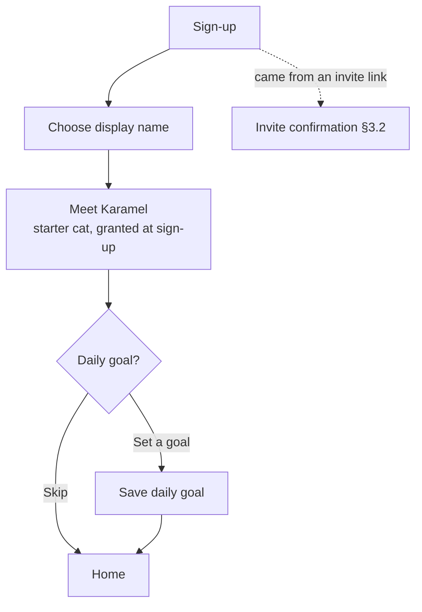
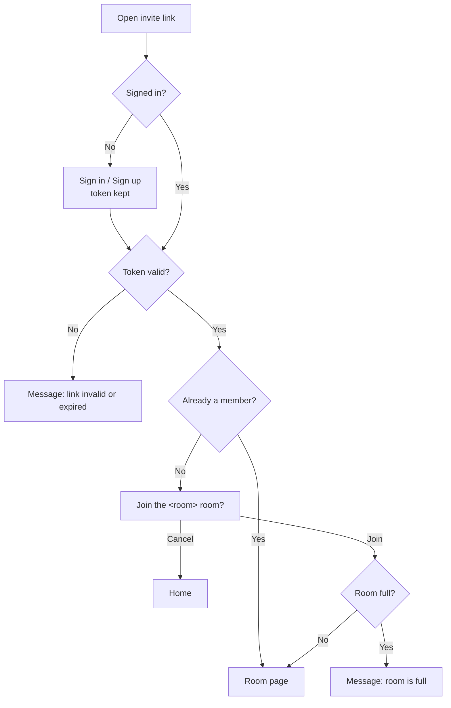
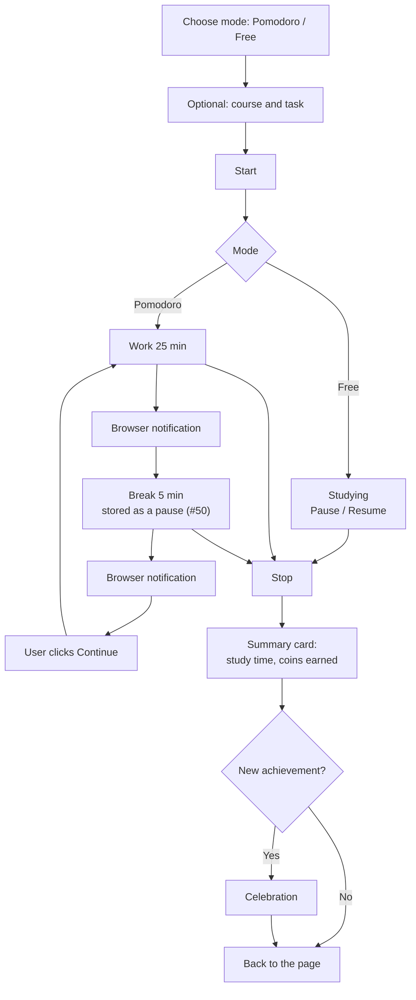
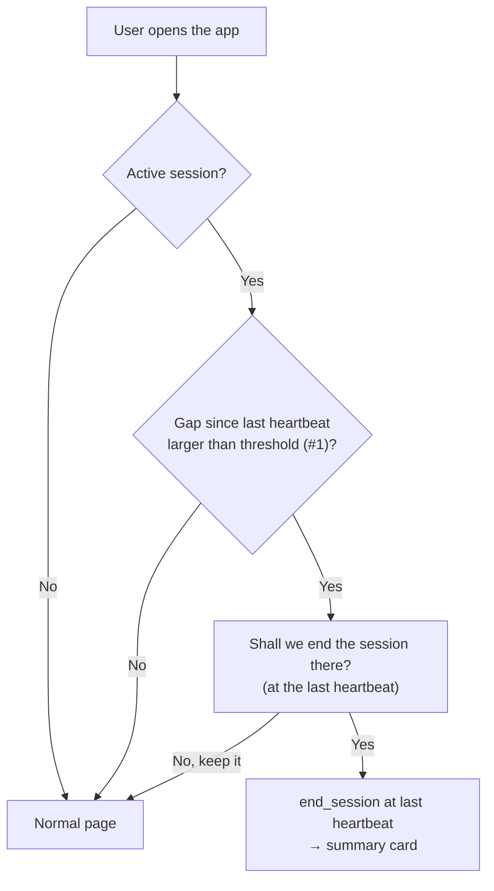

# UI/UX design

Last updated: 2026-11-23 · Phase 0 · **Status: decided (tasks 010 – 010-v3)**

This is a design document; it contains no code. Layout, screens, flows and visual
direction were **accepted by the user in tasks 010 – 010-v3** (former OPEN_QUESTIONS
#67–#75).

General rules from earlier decisions, valid on every screen:

- **Desktop browser only** (CURRENT_STATE "Platform").
- **No hardcoded text:** every label is an i18n key, TR + EN; user content (names,
  courses, messages) is not translated (ADR-0010). Dates, numbers and durations use `Intl`
  for the current locale. The greeting "Hello, <name>!" is one key with the name as a
  parameter.
- **Rooms show only time data**, never courses or tasks (ADR-0006). **Never a sum across
  rooms** (ADR-0005).
- **Gamification data is private:** coins, cats and items are shown only to their owner
  (DATABASE.md #55).
- Server data is loaded with TanStack Query (ADR-0009); Zod validates input (ADR-0015).

## Contents

1. [Layout](#1-layout)
2. [Screens](#2-screens)
3. [Flows](#3-flows)
4. [Empty states](#4-empty-states)
5. [Error states](#5-error-states)
6. [Visual direction](#6-visual-direction)

---

## 1. Layout

Decided (task 010):

```
┌─────────────┬──────────────────────────────────────────────────────┐
│  [Karamel,  │  ▶ Studying · 00:42:15                 [ Stop ]       │ ← timer strip
│   dressed]  ├──────────────────────────────────────────────────────┤   (only while
│             │                                                      │    a session runs)
│  Home       │                                                      │
│  Courses    │                 page content                         │
│  Statistics │                                                      │
│  Rooms      │                                                      │
│  Karamel    │                                                      │
│  Achievements                                                      │
│  Settings   │                                                      │
└─────────────┴──────────────────────────────────────────────────────┘
```

- **Left menu, fixed.** Above the menu: the user's Karamel wearing their equipped items,
  drawn with the automatic placement rules
  ([assets README](assets/README.md#automatic-placement), ADR-0028). Clicking it opens the
  Karamel screen.
- **Timer strip** at the top of every page while a session is active: mode, elapsed time
  and a **Stop** button. Elapsed time = server now − `started_at` − pauses (ADR-0003); it
  is the same in every tab. While paused or on a Pomodoro break, the strip shows
  "Paused" or "Break" with the remaining break time (#68). The strip is **not shown on
  Home**, where the timer card already shows the same thing (#74).
- Minimum supported window width: **1024 px** (#74).

---

## 2. Screens

Each screen: purpose · components · data shown. Data sources refer to
[DATABASE.md](DATABASE.md).

### 2.1 Sign-in / Sign-up

- **Purpose:** create an account or sign in (Supabase Auth, ADR-0001).
- **Components:** email and password fields; switch between sign-in and sign-up; language
  switch (TR/EN) before sign-in.
- **Data:** none before sign-in. Email confirmation is off for the friend-group stage
  (ADR-0027), so sign-up goes straight to the first-login flow (§3.1).
- If the user arrived from an invite link, the token is kept until sign-in finishes
  (§3.2).

### 2.2 Home

- **Purpose:** start studying quickly and see today at a glance.
- **Layout** (decided, task 010-v2):

```
┌──────────────┬─────────────────────────────────────────────────────────┐
│ ┌──────────┐ │  Hello, <name>!                       [🪙 coins] [🔥 streak] │
│ │ Karamel  │ │ ┌───────────────────────────────────┐ ┌─────────────────┐ │
│ │ (dressed)│ │ │ Timer card (#8E5222 background)   │ │ Goal rings:     │ │
│ └──────────┘ │ │ 2 columns wide                    │ │ daily · weekly  │ │
│  Home        │ │                                   │ │ · streak        │ │
│  Courses     │ └───────────────────────────────────┘ └─────────────────┘ │
│  Statistics  │ ┌───────────────┐ ┌───────────────┐ ┌───────────────────┐ │
│  Rooms       │ │ My rooms      │ │ Today's tasks │ │ Monthly study     │ │
│  Karamel     │ │               │ │               │ │ calendar          │ │
│  Achievements│ └───────────────┘ └───────────────┘ └───────────────────┘ │
│  Settings    │ ┌──────────────────────────────────────────────────────┐ │
│              │ │ Achievements strip (full width)                       │ │
└──────────────┴─────────────────────────────────────────────────────────┘
```

- **Components:**
  - **Left menu** with the dressed Karamel card at the top (§1).
  - **Greeting** "Hello, <name>!" (display name from `profiles`) with **coin** and
    **streak** badges.
  - **Row 1:** the **timer card**, two columns wide, on a **dark caramel background `#8E5222`** (§6.2 rules): mode
    choice (Pomodoro / free), optional course and task, Start; while running: elapsed time,
    phase (Pomodoro work/break), Pause/Resume, Stop. Next to it, the **goal rings**: daily
    goal, weekly goal and streak.
    - **Streak ring:** fills with today's study time toward the 25 minutes that count the
      day; the number in the middle is the current streak (#70).
  - **Row 2:**
    - **My rooms** — each room with who is online (Presence) and who is studying (active
      session, ADR-0006). No time totals here, so no sum across rooms is shown.
    - **Today's tasks** — open (not done) tasks plus tasks completed today; tasks have no
      due date in the first version (#67).
    - **Monthly study calendar** — days coloured in **4 tones by study minutes**, **today
      framed** (a small custom grid, ADR-0015). Personal only. Tones and ranges: §6.2.
  - **Row 3:** a full-width **achievements strip** — earned achievements, latest first,
    and the next ones to earn.
- **Data:** active session and pauses; today's and this week's study minutes; goals from
  `user_settings`; streak and balance from database functions (ADR-0024); rooms,
  memberships, Presence; tasks; `user_achievements`.

### 2.3 Courses and tasks

- **Purpose:** manage the user's own courses and tasks (#49; owner-only).
- **Components:** course list (add, rename, archive); tasks per course and tasks without a
  course (add, edit, mark done).
- **Data:** `courses`, `tasks`. Archived courses are hidden from pickers but stay in
  statistics.

### 2.4 Statistics

- **Purpose:** see progress; fix the session history.
- **Components:**
  - **Weekly / monthly charts** (Recharts, ADR-0015): study time per day; per course
    (joins the private `session_details`, ADR-0016).
  - **Goal progress:** days and weeks that met the current goal (ADR-0025: past days use
    the current goal).
  - **Session history:** list of sessions with start, end, study time, mode, course/task.
    Actions: **edit** start/end, **add a session manually**, **delete** a session
    (ADR-0007, #52).
- **Data:** the user's own sessions, pauses and details. Calculated in TypeScript
  (display-only, ADR-0024).
- Editing rules shown in the form: end not in the future (#57), no overlap with another
  session (ADR-0011), pauses clipped to the new range (#51). Coins are recalculated; the
  form shows the coin difference after saving (from the function result).

### 2.5 Rooms

- **Purpose:** see the user's rooms, create a room.
- **Components:** room cards (name, members online, who is studying); **Create room**
  (name 1–50 characters, member limit, #53, ADR-0012). Joining is by invite link only
  (§3.2); there is no room search.
- **Data:** `rooms`, `room_memberships`, Presence, active sessions.

### 2.6 Room page

- **Purpose:** study together: who is here, how much the room studies, chat.
- **Components:**
  - **Members and live status:** online/offline (Presence), studying + elapsed time
    (active session), role badges (owner, creator role). Former members are not listed by
    name (ADR-0014).
  - **Time:** per-member time in this room, **room total** and **room shared time**
    (ADR-0005), for a week / month range. Labels explain the difference between total and
    shared time (ADR-0005 consequence). No ordered ranking (OPEN_QUESTIONS #27 is still
    open).
  - **Chat:** the room's whole history (#54), newest at the bottom, 1–1,000 characters
    (#53). Messages are plain text (SECURITY.md X1). No editing or deleting.
  - **Invite link:** visible and copyable by every member (ADR-0023); **Regenerate** for
    owners (ADR-0014).
  - **Room actions** (ADR-0014): leave; for owners: remove a member, make or remove an
    owner, change the member limit; for the creator-role holder: hand over the role, delete
    the room. They live in a **"Room settings" panel** on the room page; **Leave** is at
    the bottom of the panel (#73).
- **Data:** room, memberships, `profiles` of current members, roommates' sessions and
  pauses (time-only, ADR-0016), chat (Realtime), Presence (private channel, ADR-0017).
- Leaving as the last member shows a warning that the room will be deleted (ADR-0014).
  Deleting the room asks for **no confirmation** and notifies nobody (ADR-0014).

### 2.7 Karamel (dressing + shop)

- **Purpose:** dress Karamel and buy items — one screen.
- **Components:**
  - **Left:** Karamel, large, with the equipped items, drawn by the automatic placement
    rules (assets README, ADR-0028), with headroom above the cat for tall hats.
  - **Right:** items grouped by slot (head, neck; the eyes slot is empty in the first
    version, ADR-0028). Each item shows its image, name and state.
  - **Owned item:** a click puts it on (one item per slot; it replaces the current item in
    that slot). **Clicking the worn item again takes it off** (#72).
  - **Item not owned:** a click shows a **preview** on Karamel (not saved) and a button
    **"Buy (price)"**.
  - **Not enough coins:** the button is disabled and shows **"You need to study X more
    minutes"**, with X = 2 × (price − balance), because studying earns 1 coin per
    2 minutes (ADR-0021). This also covers a negative balance (no buying while negative,
    ADR-0021). X is a lower bound: coins are rounded down per session.
  - Balance at the top.
- **Data:** `items` (with placement columns), `cats` (landmarks), `user_items`,
  `cat_equipment`, balance. Buying calls `buy_item`; equipping writes `cat_equipment`
  (DATABASE.md §4, §5.4).

### 2.8 Achievements

- **Purpose:** see earned and not-yet-earned achievements.
- **Components:** the five achievements (ADR-0021) with name, condition and coins; earned
  ones with their date. **Not-yet-earned ones show their condition and progress** (e.g.
  "12 / 25 min") (#72).
- **Data:** `achievements` catalog, `user_achievements`.

### 2.9 Settings

- **Purpose:** personal settings.
- **Components:** display name (1–30 characters, #53); daily goal and weekly goal in
  minutes, each optional and clearable (ADR-0025); language (TR/EN); timezone.
- **Data:** `profiles`, `user_settings`. Account deletion is not shown: it is a later
  phase (CURRENT_STATE).
- A note next to the goals: changing a goal changes how past days look (ADR-0025). A note
  next to the timezone: past days are re-evaluated with the new timezone (#56).

### 2.10 Invite confirmation

- **Purpose:** confirm joining a room from a link.
- **Components:** "Join the <room> room?" with **Join** and **Cancel**.
- **Data:** the room name for a valid token. Reading the name before joining needs a
  function that returns only the name for a valid token (non-members cannot read `rooms`,
  DATABASE.md §4), so the name comes from `get_invite_room_name` (DATABASE.md §5.5,
  #73).

---

## 3. Flows

### 3.1 First login (decided)



- Timezone and language are taken from the browser at sign-up (#56); they can be changed
  in Settings.
- If the user came from an invite link, the invite confirmation follows the first-login
  steps (#73).

### 3.2 Joining by link (decided)



- A wrong token and a deleted room give the same message (SECURITY.md F7).
- 🚀 Before public launch, the token is removed from the address bar after it is read
  (ADR-0027).
- "Already a member" goes straight to the room (Claude's addition; no join is needed).

### 3.3 Study session (decided)



- **Pomodoro is fixed at 25 minutes of work and 5 minutes of break** (decided). Breaks are
  pauses, so they earn nothing (#50).
- **Phase changes (#68):** the break **starts automatically at 25:00** and is recorded as a
  pause starting at that exact time, even if the page was closed. The next work phase
  starts **only when the user clicks "Continue"**, so an absent user is not credited with
  study time; the pause simply lasts until then.
- **Notifications (#69):** permission is asked when the user starts their **first
  Pomodoro**. If it is denied, phase changes are shown only in the page (tab title and
  timer card). Notifications work only while the app is open in a tab (no PWA)
  **[not verified]**.
- The summary card shows the study time and the coins from `end_session` (ADR-0021); a
  celebration appears for each achievement granted by the reward check (DATABASE.md §5.3).
  Achievements granted to roommates are not shown to the current user.

### 3.4 Forgotten timer (decided)



- The app only **suggests**; nothing changes without the user's choice (ADR-0007). The
  gap threshold is still open (OPEN_QUESTIONS #1).

---

## 4. Empty states

| Where | When | What is shown |
| --- | --- | --- |
| Home — timer card | No session yet | The normal Start card; a short line inviting the first session |
| Home — study calendar | No sessions at all | The empty grid with a line like "Your study days will appear here" |
| Home — rings | No goal set | Daily/weekly rings show "No goal" and a link to Settings (goals are optional, ADR-0025) |
| Home — My rooms | No rooms | "You are not in a room yet" with **Create room** and a note that friends can send an invite link |
| Home — Today's tasks | No open tasks and none completed today (#67) | "No tasks for today" with a link to Courses and tasks |
| Home — Achievements strip | None earned | The first achievement to aim for ("First step": a 25-minute session) |
| Statistics | No sessions at all | Empty chart frames with "Start your first session" and **Add a session manually** |
| Rooms | No rooms | Same as Home — My rooms, larger |
| Room page — chat | No messages | "Say hello to the room" |
| Room page — time | Nobody studied in the range | Zeros with the range label; no empty chart |
| Courses and tasks | Nothing yet | **Add course** and **Add task** |
| Karamel | No items owned | Karamel without items; the items list shows prices and how many minutes are needed |
| Achievements | None earned | All five shown as not yet earned |

Empty states use a small Karamel illustration where it fits (art from `docs/assets/`).

---

## 5. Error states

Errors come from database functions as codes mapped to i18n keys (ADR-0010, DATABASE.md
§5). The UI never shows raw database messages.

| Situation | Where | What is shown |
| --- | --- | --- |
| Overlapping session (SQLSTATE `23P01`, ADR-0011) | Edit / manual session form | "This time overlaps another session"; the form stays open |
| End time in the future (#57) | Edit / manual session form | "The end time cannot be in the future" |
| Start after end | Edit / manual session form | Inline field error (Zod) before saving |
| Session already active (another tab or device) | Start | "A session is already running"; the app shows that session |
| Invalid or expired invite link | Invite flow | "This link is invalid or expired" (same for a deleted room, SECURITY.md F7) |
| Room full (ADR-0012) | Invite flow | "This room is full" |
| Not enough coins / negative balance | Karamel | Disabled Buy button with "You need to study X more minutes" (not an error dialog) |
| Text too long (#53) | Name, room name, chat | Inline counter and error before sending (Zod); the database refuses it too |
| Not allowed (e.g. a member tries an owner action after losing the role) | Room page | "You no longer have permission for this"; the page refreshes the room data |
| Room deleted while open | Room page | "This room no longer exists"; back to Rooms (ADR-0014) |
| Removed from a room while on its page | Room page | "You are no longer a member of this room"; back to Rooms |
| No connection / request failed | Anywhere | A small banner "Connection lost, retrying"; actions that failed can be retried; the running timer keeps showing time (it is computed from `started_at`) |
| Live updates disconnected (Realtime) | Room page, Home | A small "Live updates paused" hint; data is refreshed when the connection returns |
| Supabase project paused (free plan, ADR-0001) | Anywhere | A general "Service unavailable" page; the project owner must resume it from the dashboard |
| Notification permission denied | Pomodoro | Phase changes are shown in the page only (#69) |

---

## 6. Visual direction

### 6.1 Decided (task 010)

- **Reference style:** pastel, low-contrast, cards with large rounded corners, ring
  charts, a personal greeting.
- **Colours from Karamel:** cream background, caramel orange accent, soft brown text,
  small pink accents.
- **Art:** cat and item images from `docs/assets/`; items placed by the rules in the
  [assets README](assets/README.md#automatic-placement).

### 6.2 Colour palette (decided, task 010-v2)

Approved by the user on a mockup.

| Role | Hex |
| --- | --- |
| Outer background (around the app) | `#EFE3D3` |
| App background | `#FBF6EF` |
| Card | `#F4E9DC` |
| Inactive / empty area (empty rings, empty calendar days) | `#EAD8C3` |
| Accent (caramel) | `#A8642A` |
| Accent dark / hover | `#8E5222`, `#7E4818` |
| Caramel mid | `#C9813F` |
| Caramel light | `#E9B27A` |
| Text | `#4A3426` |
| Secondary text | `#7A5E4B`, `#6B4F3C` |
| Text on accent | `#FFF8F0` |
| Pink accent | `#B5525E` |
| Light pink | `#F6DDE0` |
| "Studying" green | dot `#4F7A4B`, text `#3F6A3C` |

#### Study calendar tones (decided, task 010-v3)

| Study time that day | Colour |
| --- | --- |
| None | `#EAD8C3` (inactive) |
| 1–29 min | `#E9B27A` |
| 30–59 min | `#C9813F` |
| 60–119 min | `#A8642A` |
| ≥ 120 min | `#7E4818` |

Today has a frame. The exact minutes of each day are shown in a **tooltip**, because the
lighter tones do not reach 3:1 against the background.

#### Contrast check

WCAG 2 contrast ratios, calculated with the relative-luminance formula (a script, not a
browser tool). Normal text needs **4.5:1**; large text (about 24 px, or 18.7 px bold) and
non-text graphics (rings, icons, dots) need **3:1**.

| Text colour | On app `#FBF6EF` | On card `#F4E9DC` | On outer `#EFE3D3` | On inactive `#EAD8C3` | On light pink `#F6DDE0` |
| --- | --- | --- | --- | --- | --- |
| Text `#4A3426` | 10.79 | 9.69 | 9.17 | 8.35 | 9.02 |
| Secondary `#6B4F3C` | 6.95 | 6.24 | 5.91 | 5.38 | 5.82 |
| Secondary `#7A5E4B` | 5.53 | 4.97 | 4.70 | **4.28** | 4.63 |
| Accent `#A8642A` | **4.32** | **3.88** | **3.67** | **3.34** | **3.61** |
| Accent dark `#8E5222` | 5.78 | 5.19 | 4.91 | **4.47** | 4.83 |
| Accent dark `#7E4818` | 6.91 | 6.20 | 5.87 | 5.34 | 5.78 |
| Caramel mid `#C9813F` | **2.92** | **2.62** | **2.48** | **2.26** | **2.44** |
| Pink `#B5525E` | 4.51 | **4.05** | **3.83** | **3.49** | **3.77** |
| Green text `#3F6A3C` | 5.85 | 5.25 | 4.97 | 4.53 | 4.89 |

| Text on a coloured background | Ratio |
| --- | --- |
| `#FFF8F0` on accent `#A8642A` (timer card, buttons) | **4.41** |
| `#FFF8F0` on `#8E5222` | 5.90 |
| `#FFF8F0` on `#7E4818` | 7.05 |
| `#FFF8F0` on pink `#B5525E` | 4.60 |
| `#FFF8F0` on caramel mid `#C9813F` | **2.98** |
| `#FFF8F0` on caramel light `#E9B27A` | **1.79** |
| Text `#4A3426` on caramel light `#E9B27A` | 6.14 |
| Text `#4A3426` on caramel mid `#C9813F` | **3.70** |

**Below 4.5:1 for normal text** (bold in the tables):

1. **`#FFF8F0` on the accent `#A8642A` = 4.41** — the timer card and primary buttons. Fine
   for the large timer digits (≥ 3:1), slightly too low for normal-size button labels and
   small text on the timer card.
2. **Accent `#A8642A` as text** on every background (3.34–4.32) — e.g. links or coloured
   labels at normal size.
3. **Pink `#B5525E` as text** on every background except the app background (4.51 there).
4. **Secondary `#7A5E4B` on the inactive colour `#EAD8C3` = 4.28.**
5. **Accent dark `#8E5222` on the inactive colour `#EAD8C3` = 4.47.**
6. **Caramel mid `#C9813F`** as text anywhere (2.26–2.92), and **`#FFF8F0` on `#C9813F`
   or `#E9B27A`**, and **`#4A3426` on `#C9813F` = 3.70**.

Non-text graphics (3:1): the accent `#A8642A` passes on all backgrounds (3.34–4.32), the
studying dot `#4F7A4B` passes (3.58–4.63). **Caramel mid `#C9813F` (2.26–2.92) and caramel
light `#E9B27A` fail 3:1** against the backgrounds, so if they carry meaning (a ring
segment, a calendar tone), the value must also be readable another way (a number or a
tooltip).

#### Contrast rules (decided, task 010-v3)

1. Where **normal-size text** sits on an accent background (**timer card, buttons**), the
   background is **`#8E5222`** (`#FFF8F0` on it: 5.90:1). Hover uses `#7E4818` (7.05:1).
2. **Links** are **`#7E4818`** (5.34–6.91:1 on all backgrounds).
3. The **accent `#A8642A`** and the **pink `#B5525E`** are used as text **only at large
   sizes** (about 24 px, or 18.7 px bold), where 3:1 is enough.
4. **Secondary text on the inactive area `#EAD8C3`** is **`#6B4F3C`** (5.38:1).
5. **Caramel mid and light** are never used for text or as a background for text; as
   graphics they carry no meaning on their own (calendar minutes are in the tooltip).
6. **Errors:** the **pink accent `#B5525E` plus an icon**, so the error is not shown by
   colour alone; at normal text size the message itself is in the text colour `#4A3426`,
   next to the pink icon.

### 6.3 Font (decided, task 010-v2; changed in task 013-v2)

- **One font everywhere: Nunito**, **self-hosted** (no third-party font service).
- **Headings:** weights **700–800**. **Body:** weights 400–800.
- **Timer digits:** Nunito too. Its digits all have the same width (600 units) at every
  weight, so the timer does not jump; no `tnum` feature is needed (checked in P1-01).
- **Turkish characters** (ç ğ ı İ ö ş ü and capitals): all present in Nunito (checked in
  P1-01 on the Google Fonts file, version 3.602).
- Fredoka (the earlier heading font) was removed: it has no ğ Ğ İ ş Ş (task 013,
  OPEN_QUESTIONS #80, #81).

### 6.4 Sizes (decided, task 010-v2)

- Large card corner radius **26 px**; inner elements **14–18 px**.
- Clickable areas at least **44 px**.

### 6.5 Motion and focus (decided, task 010-v3)

- Animations (celebrations, transitions) follow the browser's **"reduce motion"** setting.
- **Keyboard focus is always visible** on every control.
